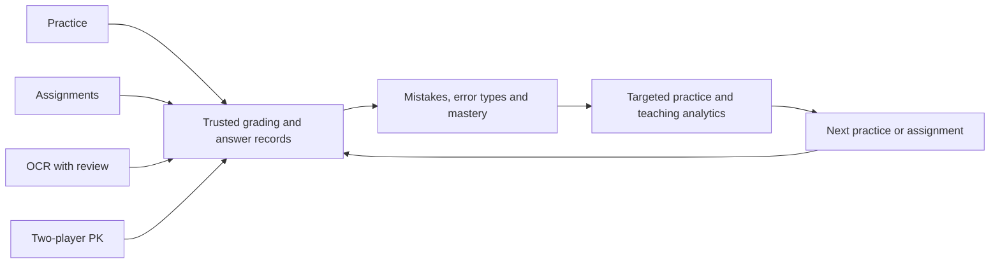
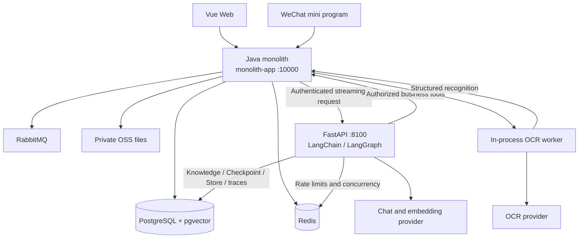

# Personalized Primary Math Learning and AI Teaching Platform

**[Live demo: jiayuhan.site](https://jiayuhan.site/)**

A graduation project for primary-school students, teachers, and administrators. It connects **personalized practice, class assignments, photo-assisted grading, two-player PK, and a teaching Agent** through one learning record, focusing on arithmetic topics from the PEP primary-school mathematics curriculum.

Students learn through the Web app and a native WeChat mini program. Teachers use class analytics, review OCR results, and prepare assignments with an Agent. Administrators manage accounts, permissions, question quality, teaching knowledge, and platform operations.

[中文说明](./README.md) · [Backend](./back/README.md) · [Agent](./agent-service/README.md) · [Deployment](./deploy/server/README.md)

> The maintained architecture is a **Java modular monolith + standalone Python Agent + Vue Web app + native WeChat mini program**. This README describes the current branch. Availability depends on initialized databases, external credentials, and feature flags. Individual and team level challenges are deferred.

## Contents

- [Overview](#overview)
- [Roles and clients](#roles-and-clients)
- [Learning workflows](#learning-workflows)
- [Teaching Agent](#teaching-agent)
- [Architecture](#architecture)
- [Technology stack](#technology-stack)
- [Repository structure](#repository-structure)
- [Local development](#local-development)
- [Demo data](#demo-data)
- [Validation and observability](#validation-and-observability)
- [Deployment and current boundaries](#deployment-and-current-boundaries)
- [Documentation](#documentation)

## Overview



All entry points preserve their own task and source records while feeding shared mistake tracking, knowledge-point mastery, and reinforcement recommendations. Questions come from a reviewed, enabled database question bank with standard answers.

## Roles and clients

| Role          | Main capabilities                                                                                                                                                 |
| ------------- | ----------------------------------------------------------------------------------------------------------------------------------------------------------------- |
| Student       | Practice, class membership, assignments, mistakes, mastery, recommendations, photo upload and confirmation, PK matches, history and rewards                       |
| Teacher       | Own-class management, unified/layered assignments, submissions and comments, class/student reports, alerts, OCR review, and the teaching Agent                    |
| Administrator | Platform-wide student reports, accounts/RBAC, content and question review, error types, question feedback, OCR review, knowledge management, operations and audit |

- **Web:** A shared Vue app with role switching, student learning pages, teacher workflows, OCR review, content administration, and the Agent interface.
- **WeChat mini program:** Native pages for authentication, profiles, practice, classes, assignments, photo marking, two-player PK, notifications, and growth records. Teachers can also manage classes and assignments.
- **Authorization:** Frontend navigation reflects the current role and permissions; Java independently checks permissions and resource ownership. Backend IDs are transmitted as strings to preserve JavaScript integer precision.

## Learning workflows

### Practice and recommendations

Content is organized as content modules → knowledge points ↔ questions, with grade, semester, publisher, and edition stored as attributes. Seed scripts cover PEP arithmetic content for grades 1–6.

The backend creates fixed-question practice tasks, grades normalized answers, updates mistakes and mastery, and generates reinforcement recommendations from learning-domain rules and review timing. Accepting a recommendation creates another practice task. Grading does not use an LLM; recommendation effectiveness still needs calibration with real learning data.

### Classes and assignments

Students join classes by code. Teachers manage their active classes and publish unified or layered assignments, including per-student layer selection. Answers are saved during work and graded after the complete assignment is submitted. Submitted answers cannot be edited further.

Class analytics include completion and accuracy rates, weak knowledge points, frequent mistakes, error types, trends, and student alerts. Teachers can drill down to student reports and prepare targeted practice or assignments.

### Photo-assisted grading

OCR runs in a **Java monolith worker**, separately from the teaching Agent. The current integration uses Alibaba Cloud Qwen-VL-OCR; internal worker contracts remain available for later extraction or provider replacement.

```text
Private image upload → photo task → worker reads the original image
    → question text, student answer, coordinates and confidence
    → match the reviewed question bank
    ├─ confidence ≥ 0.85 and successful match: automatic confirmation and grading
    └─ low confidence or no match: student / teacher / administrator review
    → shared learning record, mistakes, mastery and recommendations
```

The review workbench provides filters, image/recognition/question comparison, per-item review, high-confidence batch approval, failed-task retry, and before/after audit snapshots.

The root configuration template disables OCR by default. Enable `AI_OCR_ENABLED` and supply `AI_OCR_API_KEY`, or reuse `AI_MODEL_API_KEY`. Disabled or unconfigured workers leave tasks waiting for recognition. Actual processing failures produce failure states rather than simulated recognition. Prompts require extracting student answers rather than solving questions for students.

### Two-player PK

Students create or join a friend room by code, or use random matching. Both players answer the same ordered question set within the configured time limit. The mini program polls progress and displays the countdown, score, and streaks.

The server owns idempotent answer handling, grading, timeout settlement, results, points, experience, and rating updates. Transactional outboxes and RabbitMQ deliver answer results to the learning domain, so PK mistakes also update the shared learning record.

## Teaching Agent

The Agent assists teachers and administrators with class analysis, teaching references, fixed-question selection, and assignment preparation. The Web interface shows SSE output, tool states, citations, feedback, and confirmation cards.

### Orchestration and tools

FastAPI provides the HTTP/SSE boundary. LangChain `create_agent` handles model/tool execution, while LangGraph provides graph state and persistence.

| Tool                          | Purpose                                                   | Constraint                                                                                                          |
| ----------------------------- | --------------------------------------------------------- | ------------------------------------------------------------------------------------------------------------------- |
| `get_class_dashboard`         | Read class metrics, weak points, trends, and alerts       | Java checks permissions and class ownership                                                                         |
| `search_questions`            | Retrieve assignment candidates                            | Reviewed, enabled fixed questions with standard answers only                                                        |
| `retrieve_teaching_knowledge` | Retrieve textbook, lesson-plan, or teaching-rule evidence | Agent-owned knowledge store with traceable sources                                                                  |
| `create_assignment_draft`     | Prepare a signed assignment proposal                      | Requires class analysis and question retrieval in the current run; explicit confirmation precedes business creation |

Java dynamically supplies the allowed business tools. A typical request is to analyze the last 30 days for an authorized class, consult teaching references, and prepare a ten-question reinforcement assignment.

### Agentic RAG and memory

Knowledge management performs Chinese recursive text splitting, embedding, and pgvector storage. Retrieval uses vector search with MMR, followed by model relevance grading. If no useful evidence is found, the graph can rewrite the query and retrieve again; the default rewrite limit is one. Results retain document IDs, source URIs, and chunk IDs.

| Mechanism             | Responsibility                                                                                             |
| --------------------- | ---------------------------------------------------------------------------------------------------------- |
| PostgreSQL Checkpoint | Conversation messages and graph state, isolated by user, conversation, and active role                     |
| PostgreSQL Store      | Semantic memory across conversations, isolated by user and role, with retention and forgetting             |
| Redis                 | Agent rate limiting and concurrency control; no Agent conversation content                                 |
| Java AI layer         | Identity, dynamic tool authorization, HMAC signatures, replay protection, SSE forwarding, and final writes |
| Quality and audit     | Run/tool traces, timings, failures, feedback, metrics, redaction, cleanup, and offline evaluation          |

Python accesses its own knowledge, memory, and trace tables. Business data is read through controlled Java tools. The model does not directly read or write user, class, or assignment tables. Student alerts use aliases in model-visible data; common credential patterns are redacted from traces and long-term memory.

Assignment execution follows **proposal → confirmation card → user confirmation → Java validation → teaching-domain draft creation**. Publishing remains a separate teaching workflow.

Chat and embedding use configurable OpenAI-compatible interfaces. Disabled AI or missing model configuration returns an explicit unavailable state.

## Architecture



`back/monolith-app` is the only Java startup entry point. Domain modules run in one JVM with one `monolith_db`; synchronous calls use local adapters, and asynchronous events retain RabbitMQ and transactional outboxes. The active runtime does not require Gateway, Nacos, or service discovery.

| Module                 | Responsibility                                                                  |
| ---------------------- | ------------------------------------------------------------------------------- |
| `user`                 | Accounts, WeChat authentication, profiles, roles and permissions                |
| `content`              | Modules, knowledge points, question review, error types and feedback            |
| `learning`             | Practice, grading, records, mistakes, mastery, recommendations and photo review |
| `teaching`             | Classes, assignments, publication, submissions and teaching queries             |
| `game`                 | PK sessions, settlement, rewards and answer events                              |
| `file-service`         | File metadata, ownership and private OSS access                                 |
| `notification-service` | Notifications and read status                                                   |
| `audit-service`        | Operation and data-change auditing                                              |
| `ai`                   | Agent bridge, tool tokens, business adaptation and confirmation                 |
| `common`               | Shared web, data, security, Redis, messaging, OpenAPI and observability         |
| `monolith-app`         | Assembly, authentication, local adapters, OCR and runtime configuration         |

## Technology stack

| Layer              | Technology                                                                  |
| ------------------ | --------------------------------------------------------------------------- |
| Backend            | Java 21, Spring Boot 4.0.6, MyBatis-Plus 3.5.15, Sa-Token 1.39.0, Springdoc |
| Agent              | Python 3.12+, FastAPI, Pydantic, LangChain 1.x, LangGraph 1.x               |
| RAG and state      | PGVectorStore, pgvector, PostgreSQL Checkpoint / Store                      |
| Web                | Vue 3, TypeScript, Vite, Pinia, Vue Router, TDesign Vue Next, ECharts       |
| Mini program       | Native TypeScript, WXML, WXSS, TDesign Miniprogram                          |
| Data and messaging | PostgreSQL 18, Redis, RabbitMQ, transactional outboxes                      |
| External services  | Alibaba Cloud OSS, OpenAI-compatible models, Qwen-VL-OCR                    |
| Operations         | Docker Compose, Caddy, Prometheus, Grafana, Jenkins configuration           |

Exact dependencies are maintained in Maven POMs, `package-lock.json`, and `agent-service/requirements.lock`.

## Repository structure

```text
graduation-project/
├─ back/                 Java modules and database scripts
│  └─ monolith-app/      Sole Java application entry point
├─ agent-service/        FastAPI Agent, migrations, tests and evaluation cases
├─ front/
│  ├─ management/       Shared multi-role Vue Web app
│  └─ miniprogram/      Native WeChat mini program
├─ deploy/               Containers, reverse proxy, monitoring and Jenkins
├─ 文档/                 Business and database documentation
├─ .env.example          Secret-free environment template
├─ docker-compose.yaml
└─ docker-compose.server.yaml
```

## Local development

The default workflow runs Java, Python, and the Web app locally against prepared shared PostgreSQL, Redis, RabbitMQ, and OSS services. Independent deployments must supply their own infrastructure and credentials.

Required tools are JDK 21 with `JAVA_HOME`, Node.js `^20.19.0 || >=22.12.0`, npm, and Python 3.12+. The Agent also requires pgvector and configured chat/embedding APIs. The commands below use uv for the Python environment. Run each startup block from the repository root in a separate terminal.

```powershell
if (-not (Test-Path .env)) { Copy-Item .env.example .env }
```

Configure database and middleware connections, OSS variables, and optional WeChat/AI credentials. Additional OSS and bootstrap-admin variables are documented in [`back/.env.example`](./back/.env.example). Use strong bridge/internal credentials and a tool signing secret of at least 32 characters. Embedding dimensions must match the vector schema; the template uses 1024.

Java and the Agent read the root `.env`. AI-specific database/Redis variables can override the shared connections. Keep secrets out of Git, browser `VITE_` variables, and mini-program source.

For a **new database**, create `monolith_db`, then initialize it using `back/database/init-schema.sql` and `back/database/seed-data.sql`. These scripts are not a routine startup step for existing databases. Agent migrations run at startup; the first LangChain/LangGraph migration removes legacy handwritten RAG/memory tables. See the [Agent README](./agent-service/README.md) before upgrading an existing installation.

### Java

```powershell
Set-Location back
.\mvnw.cmd clean verify
& "$env:JAVA_HOME\bin\java.exe" -jar monolith-app\target\monolith-app-0.0.1-SNAPSHOT.jar
```

### Agent (optional)

Enable `AI_ENABLED` in Java and configure reachable `AI_AGENT_BASE_URL` / `JAVA_AI_TOOL_BASE_URL`, chat, embedding, and service credentials.

```powershell
Set-Location agent-service
uv venv --python 3.12 .venv
uv pip install --python .venv\Scripts\python.exe --constraint requirements.lock -e ".[dev]"
$env:AI_RELOAD = "true"
.\.venv\Scripts\python.exe -m app.server
```

Skip environment creation if it already exists. On Windows, use `app.server` to preserve the Selector event loop required by psycopg.

### Web

```powershell
Set-Location front/management
if (-not (Test-Path .env.local)) { Copy-Item .env.example .env.local }
npm ci
npm run dev
```

Vite proxies `/api` to `http://127.0.0.1:10000`. The usual development URL is `http://localhost:5173`. Website WeChat QR login is disabled by default and requires a separately approved website application and callback domain.

### WeChat mini program

```powershell
Set-Location front/miniprogram
npm ci
npm run check
```

Import the directory into WeChat DevTools with your own AppID, enable TypeScript compilation, and build npm components. API addresses are defined in [`environment.ts`](./front/miniprogram/miniprogram/config/environment.ts). A real device needs a reachable API address. Trial/release addresses are currently empty and must be configured with approved HTTPS domains before publishing.

## Demo data

After schema and question-bank initialization, execute `back/database/demo-data.sql`, then `verify-demo-data.sql`. Fixed demo IDs make the script repeatable; assignment and trend dates are refreshed relative to the current date.

| Entry   | Account / class code | Password    |
| ------- | -------------------- | ----------- |
| Teacher | `demo_teacher`       | `Demo@2026` |
| Student | `demo_student`       | `Demo@2026` |
| Class   | `DEMO2026`           | —           |

These public accounts are for demonstration environments. [`demo-data-reset.sql`](./back/database/demo-data-reset.sql) removes records in the script-defined 81–89 demo ID ranges.

## Validation and observability

| Directory           | Command                                                       |
| ------------------- | ------------------------------------------------------------- |
| `back`              | `.\mvnw.cmd clean verify`                                     |
| `front/management`  | `npm run check`                                               |
| `front/miniprogram` | `npm run check`                                               |
| `agent-service`     | `.\.venv\Scripts\python.exe -m ruff check app tests`          |
| `agent-service`     | `.\.venv\Scripts\python.exe -m ruff format --check app tests` |
| `agent-service`     | `.\.venv\Scripts\python.exe -m pytest -q`                     |

Offline Agent evaluation, from `agent-service`:

```powershell
.\.venv\Scripts\python.exe -m app.evaluation evals/teaching-agent.jsonl --threshold 0.8
```

| Endpoint / route                  | Purpose                                                |
| --------------------------------- | ------------------------------------------------------ |
| Java `:10000/swagger-ui.html`     | OpenAPI documentation                                  |
| Java `:10000/actuator/health`     | Health                                                 |
| Java `:10000/actuator/prometheus` | Prometheus metrics                                     |
| Agent `:8100/health`              | Process liveness                                       |
| Agent `:8100/ready`               | Database/Redis connectivity and required configuration |
| Agent `:8100/metrics`             | Agent, tool and RAG metrics                            |
| Web `/ai/teaching-agent`          | Teacher/administrator Agent                            |
| Web `/ai/knowledge-base`          | Administrator knowledge management                     |

`/ready` checks model/embedding configuration without calling the provider. Real requests must validate provider availability. Internal Agent business endpoints require Java bridge credentials. Automated checks do not establish OCR accuracy or complete multi-client acceptance.

Prometheus and Grafana configuration includes Spring Boot and Agent dashboards. Business operations, Agent quality, and audit views provide separate perspectives on learning workflows, model behavior, and user actions.

## Deployment and current boundaries

- Root Compose files provide infrastructure, monitoring, Jenkins, and an Agent instance. `deploy/server/docker-compose.app.yaml` runs Java and the Agent against an existing infrastructure network.
- Choose the Agent deployment location to avoid duplicate instances. The application Compose uses `INFRA_NETWORK_NAME`, enables AI, requires model/service credentials, and explicitly requires `AI_OCR_API_KEY`; local templates disable AI/OCR by default.
- Caddy serves the Web build and proxies `/api` to Java, including streaming responses. See [`Caddyfile.production`](./deploy/caddy/Caddyfile.production) and the [deployment guide](./deploy/server/README.md).
- The scope remains primary-school arithmetic. Parent/open-platform features and individual/team level challenges are deferred.
- OCR prioritizes clear arithmetic and fill-in questions that can match the fixed bank. Complex handwriting and reasoning require evaluation and human review.
- The Agent prepares teaching advice and assignment proposals; business questions remain fixed and publishing remains teacher-controlled.
- Current priorities include real-data calibration, OCR/Agent regression samples, PK concurrency and recovery testing, monitoring, and backup restoration.

## Documentation

- [Chinese project overview and detailed setup](./README.md)
- [Backend](./back/README.md)
- [Agent](./agent-service/README.md) and [AI service walkthrough](./agent-service/AI服务系统讲解.md)
- [Web](./front/management/README.md) and [WeChat mini program](./front/miniprogram/README.md)
- [Server deployment](./deploy/server/README.md)
- [Business summary](./文档/系统功能总结.md)
- [Database design](./文档/全系统数据库建表说明.md)
- [System ER diagram](./文档/系统er图.jpg)

Some linked documents retain earlier-stage descriptions. Use this overview together with the current source and deployment configuration when assessing current capabilities.
