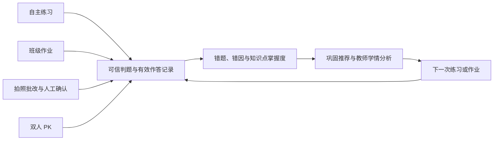
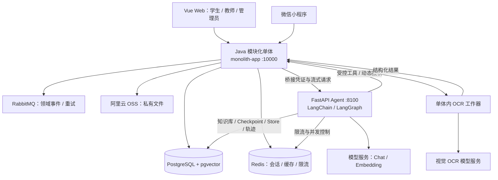

# 小学数学个性化学习与 AI 教学平台

**[在线体验：jiayuhan.site](https://jiayuhan.site/)**

面向小学生、教师和管理员的毕业设计项目，围绕人教版小学数学计算类知识点，将**个性化练习、班级作业、拍照批改、双人 PK 和教学决策 Agent**连接到同一套学习档案中。

学生通过 Web 或微信小程序完成学习任务；教师根据班级学情组织训练、复核批改结果，并通过 Agent 辅助分析和准备作业；管理员负责账号权限、题库质量、知识库和平台运营。Java 后端负责可信判题、权限与业务写入，Python 服务负责模型调用、工具编排、RAG 和会话状态。

[English](./README.en.md) · [后端说明](./back/README.md) · [Agent 说明](./agent-service/README.md) · [部署说明](./deploy/server/README.md)

> 当前维护架构为 **Java 模块化单体 + 独立 Python Agent + Vue Web + 原生微信小程序**。本文按当前分支代码整理，功能是否可用还取决于数据库初始化、外部服务配置和部署开关。单人、团队闯关暂缓。

## 目录

- [项目概览](#项目概览)
- [角色与功能](#角色与功能)
- [核心业务流程](#核心业务流程)
- [AI 教学 Agent](#ai-教学-agent)
- [系统架构](#系统架构)
- [技术栈](#技术栈)
- [仓库结构](#仓库结构)
- [本地开发](#本地开发)
- [演示数据](#演示数据)
- [验证与可观测性](#验证与可观测性)
- [部署](#部署)
- [当前边界与后续方向](#当前边界与后续方向)
- [文档导航](#文档导航)

## 项目概览

项目的核心是把不同学习入口产生的作答汇总为可追踪、可复习的学习记录，并让教师能够据此采取教学行动。



| 能力         | 当前实现                                                                   |
| ------------ | -------------------------------------------------------------------------- |
| 统一学习档案 | 练习、作业、OCR 和 PK 保留各自来源，汇入学习记录、错题、掌握度和推荐       |
| 固定题库     | 内容模块、知识点与题目分层组织；业务选题使用已审核启用、具备标准答案的题目 |
| 个性化学习   | 根据作答表现、薄弱知识点和复习时间生成规则驱动的巩固推荐                   |
| 教学协作     | 班级管理、统一/分层作业、提交反馈、班级看板和 OCR 复核                     |
| AI 教学辅助  | 受控工具查询真实学情，检索教学知识，生成待确认的作业方案                   |
| 工程支撑     | RBAC、私有文件、可靠事件、操作审计、指标监控和分层验证                     |

## 角色与功能

Web 和小程序共用账号与角色体系。同一账号可拥有多个角色，界面根据当前角色和服务端权限展示功能；业务接口还会校验资源归属。

| 角色   | 学习与教学能力                                                     | 管理与辅助能力                                                                              |
| ------ | ------------------------------------------------------------------ | ------------------------------------------------------------------------------------------- |
| 学生   | 按年级、学期、知识点练习；完成班级作业；查看错题、掌握度和巩固推荐 | 班级码加入/退出班级；小程序拍照批改与识别确认；双人 PK、历史、积分、经验和段位              |
| 教师   | 管理本人班级和学生；布置统一/分层作业；查看提交、成绩并维护评语    | 班级学情看板、学生档案、薄弱知识点和预警；OCR 工作台；教学 Agent                            |
| 管理员 | 查看全平台学生学情、学习推荐和 OCR 任务                            | 用户、角色、权限、题库和错因维护；题目反馈处理；知识库、运营看板、全局审计与 Agent 质量管理 |

### Web 与小程序

- **Web：** 提供账号登录、多角色导航、学生练习与作业、学习报告、教师工作台、内容管理、OCR 复核和教学 Agent。教师与管理员的复杂操作集中在 Web；双人 PK 的主要交互在小程序。
- **微信小程序：** 覆盖微信/账号密码登录、资料维护、练习、班级与作业、拍照上传与确认、PK 匹配与答题、通知和成长记录；教师也可以管理班级与作业。
- **跨端契约：** 后端雪花 ID 以字符串传递，避免 JavaScript 整数精度丢失；前端权限控制与 Java 服务端校验配合使用。

## 核心业务流程

### 练习、判题与个性化推荐

内容采用“内容模块 → 知识点 ↔ 题目”的组织方式，年级、学期、出版社和版本说明作为内容属性。基础种子数据包含人教版一至六年级计算类内容。

1. 学生选择知识点、难度和练习方式，服务端从固定题库组建任务。
2. Java 使用标准答案和归一化规则判题，支持数值、分数、判断等答案形式。
3. 有效作答更新错题、错因、正确率、答题用时和知识点掌握情况。
4. 系统按掌握度与复习时间生成巩固推荐；接受推荐后创建新练习，再次验证学习效果。

掌握度和推荐由学习域规则计算，判分不依赖大模型。推荐效果仍需使用真实学习数据持续校准。

### 班级与作业

- 学生通过班级码加入班级，教师维护本人有效班级和成员关系。
- 作业支持统一、分层两种类型，教师可以在发布时为学生指定层级。
- 学生从作业进入学习任务，答题期间保存答案，整份提交后统一反馈；提交后的答案不可继续修改。
- 教师查看提交情况、成绩和评语，并通过班级看板查看完成率、平均正确率、薄弱知识点、高频错题、错因、趋势和学生预警。
- 教师可以从薄弱知识点发起针对练习，或预填作业内容；查询与写入均受班级归属限制。

### OCR 拍照批改

OCR 由 **Java 单体内的工作器**处理，独立于 Python 教学 Agent。当前接入阿里云百炼 Qwen-VL-OCR，并保留内部工作器契约，便于后续替换厂商或拆分进程。

```text
小程序上传私有图片 → 创建拍照任务 → 工作器领取任务并读取原图
    → 识别题干、学生答案、区域坐标和可信度 → 匹配固定题库
    ├─ 可信度 ≥ 0.85 且匹配成功：自动确认并判题
    └─ 低可信或匹配失败：学生确认 / 教师与管理员复核
    → 有效结果写入学习档案 → 错题、掌握度与巩固推荐
```

OCR 工作台支持按班级、学生、状态和时间筛选，对照原图、题目区域、识别内容和标准题目逐题复核；可批量通过高可信结果、重试失败任务，并保留复核前后快照、处理人和说明。

根目录配置模板默认 `AI_OCR_ENABLED=false`。启用后可复用 `AI_MODEL_API_KEY`，或使用独立 `AI_OCR_API_KEY`。未启用或缺少凭据时任务保留在等待识别状态；实际调用失败时记录失败状态和摘要，不生成模拟结果。识别提示词要求提取学生作答，禁止模型替学生解题。

### 双人 PK

1. 学生创建好友房、通过房间码加入，或随机匹配对手；房主配置知识点、难度、题量和时限。
2. 双方按同一题序独立作答，小程序轮询会话进度并更新倒计时、比分和连击。
3. 游戏域处理幂等答题、计分、超时结算、胜负与积分、经验、段位更新。
4. 逐题结果通过事务发件箱和 RabbitMQ 同步到学习域，PK 错题也进入统一学习闭环。

当前实时进度通过 HTTP 轮询实现；服务端是计时、判分和结算的最终依据。

## AI 教学 Agent

教学 Agent 面向教师和管理员，服务于“查看学情 → 查找教学依据 → 筛选固定题目 → 准备作业”的具体教学任务。Web 提供流式回答、工具调用状态、资料引用、反馈和操作确认卡。

### 编排与工具

FastAPI 提供 HTTP/SSE 边界，LangChain `create_agent` 负责模型与工具循环，LangGraph 管理图状态和持久化。当前核心工具为：

| 工具                          | 作用                                 | 约束                                               |
| ----------------------------- | ------------------------------------ | -------------------------------------------------- |
| `get_class_dashboard`         | 查询班级统计、薄弱知识点、趋势与预警 | Java 校验当前用户权限及班级归属                    |
| `search_questions`            | 按知识点、题型、难度等检索作业候选题 | 仅返回已审核启用且有标准答案的固定题目             |
| `retrieve_teaching_knowledge` | 从教材、教案和教学规范中检索依据     | 在 Agent 自有知识库检索，结果保留来源与片段标识    |
| `create_assignment_draft`     | 生成带签名确认令牌的作业方案         | 本轮先读取学情并检索题库；用户确认前不创建业务作业 |

例如，教师可以提出：“查看这个班近 30 天的薄弱知识点，结合知识库给出教学建议，并准备一份 10 题的巩固作业草稿。”实际可调用的 Java 工具由服务端根据当前权限动态下发。

### Agentic RAG

管理员在 Web 知识库中维护教学资料，服务端完成中文递归分块、Embedding 和 pgvector 存储。检索子图执行：

```text
用户问题 → 向量召回 + MMR 去重 → 模型评估相关性 → 返回资料引用
                                      └─ 无有效资料且未达上限
                                          → 改写问题 → 再次检索
```

MMR 在相关性与候选多样性之间做平衡；默认最多改写一次。引用保留文档 ID、来源 URI 和片段 ID，便于回查。知识库内容作为资料处理，其中的指令不作为 Agent 的授权依据。

### 会话、记忆与安全边界

| 机制                 | 当前职责                                                                |
| -------------------- | ----------------------------------------------------------------------- |
| LangGraph Checkpoint | 在 PostgreSQL 保存线程状态与多轮消息，按用户、会话和当前角色隔离        |
| LangGraph Store      | 保存并语义召回跨会话长期记忆，按用户和角色隔离，支持保留期限及会话遗忘  |
| Redis                | Agent 用户限流和并发控制；不保存 Agent 对话内容                         |
| Java AI 接入层       | 身份与动态工具授权、HMAC 签名、动作防重放、SSE 转发和最终业务执行       |
| 审计与质量           | 运行/工具轨迹、耗时与失败记录、显式反馈、质量统计、脱敏、清理和离线评测 |

Python 访问 Agent 自有知识、记忆和轨迹表，业务数据通过受控 Java 工具读取。模型不能直接读写用户、班级、作业等业务表。发送给模型的学生预警使用匿名别名；轨迹和长期记忆对常见凭据文本脱敏。

作业确认链路为 **生成方案 → 展示确认卡 → 用户明确确认 → Java 校验签名、有效期、权限及业务条件 → 教学域创建草稿**。确认不等同于发布作业，后续发布沿用教学管理流程。

模型调用使用 OpenAI-compatible 协议，聊天模型、Embedding 模型和维度均可配置。Java AI 开关关闭或模型配置缺失时明确返回不可用。

## 系统架构



### Java 模块化单体

`back/monolith-app` 是唯一 Java 启动入口。业务模块作为 Maven JAR 在同一 JVM 内运行，共享 `monolith_db`，通过本地适配器完成同步调用。模块仍保留 API、DTO 与领域实现边界，异步事件继续使用 RabbitMQ。

| 模块                   | 职责                                                          |
| ---------------------- | ------------------------------------------------------------- |
| `user`                 | 账号、微信登录、资料、角色与权限                              |
| `content`              | 内容模块、知识点、题库审核、错因字典与题目反馈                |
| `learning`             | 练习、可信判题、学习记录、错题、掌握度、推荐与拍照复核        |
| `teaching`             | 班级成员、统一/分层作业、发布、提交与教学查询                 |
| `game`                 | 双人 PK、会话、结算、成长奖励与答题事件                       |
| `file-service`         | 文件元数据、所有权校验和 OSS 私有访问                         |
| `notification-service` | 通知接收、查询与已读状态                                      |
| `audit-service`        | 操作日志、数据变更与全局审计检索                              |
| `ai`                   | 教学 Agent 接入、工具令牌、业务适配与人工确认                 |
| `common`               | 统一响应、异常、数据访问、安全、Redis、MQ、OpenAPI 与可观测性 |
| `monolith-app`         | 模块装配、统一鉴权、跨域适配器、OCR 工作器与运行配置          |

该部署方式适配当前单机资源和毕业设计阶段，减少独立 JVM 与运维组件的数量。当前运行不依赖 Gateway、Nacos 或服务发现；历史微服务方案可在 Git 历史中对照。

### 一致性与权限

- 业务事件使用事务发件箱、发布确认和消费者重试；关键答题与同步入口进行幂等处理，避免重复更新学习结果。
- Java 入口直接校验 Sa-Token 会话，教师访问进一步受有效班级关系限制，管理员访问受权限控制。
- 题库维护使用审核状态与乐观锁版本号；OCR 人工修正保留审计快照。
- 文件读取校验所有权，私有图片通过受控访问提供给学生、复核人员和 OCR 工作器。

## 技术栈

以下版本来自仓库配置；完整依赖以 Maven POM、`package-lock.json` 和 `requirements.lock` 为准。

| 层次       | 技术                                                                                         |
| ---------- | -------------------------------------------------------------------------------------------- |
| Java 后端  | Java 21、Spring Boot 4.0.6、MyBatis-Plus 3.5.15、Sa-Token 1.39.0、Springdoc OpenAPI          |
| AI 服务    | Python 3.12+、FastAPI、Pydantic、LangChain 1.x、LangGraph 1.x、ChatOpenAI / OpenAIEmbeddings |
| RAG 与状态 | LangChain PGVectorStore、pgvector、LangGraph PostgreSQL Checkpoint / Store                   |
| Web        | Vue 3、TypeScript、Vite、Pinia、Vue Router、TDesign Vue Next、ECharts                        |
| 小程序     | 原生 TypeScript、WXML、WXSS、TDesign Miniprogram、微信开发者工具                             |
| 数据与消息 | PostgreSQL 18 + pgvector、Redis、RabbitMQ、事务发件箱                                        |
| 文件与模型 | 阿里云 OSS、OpenAI-compatible 模型接口、Qwen-VL-OCR                                          |
| 部署与监控 | Docker Compose、Caddy、Prometheus、Grafana、Jenkins 配置                                     |

## 仓库结构

```text
graduation-project/
├─ back/                         Java 多模块工程
│  ├─ monolith-app/              唯一 Java 启动入口
│  ├─ user/ content/ learning/   用户、内容与学习领域
│  ├─ teaching/ game/ ai/        教学、游戏与 AI 接入
│  ├─ file-service/              文件服务
│  ├─ notification-service/      通知服务
│  ├─ audit-service/             审计服务
│  ├─ common/                    公共基础能力
│  └─ database/                  单库初始化、种子与演示数据
├─ agent-service/                独立 Python Agent
│  ├─ app/                       API、Agent、工具、RAG、记忆与迁移
│  ├─ tests/                     自动化测试
│  └─ evals/                     离线评测用例
├─ front/
│  ├─ management/                多角色 Vue Web
│  └─ miniprogram/               原生微信小程序
├─ deploy/                       应用容器、反向代理、监控与 Jenkins 配置
├─ 文档/                          功能总结、数据库说明与 ER 图
├─ 学生端设计图纸/                 学生端页面设计参考
├─ 教师端设计图纸/                 教师端页面设计参考
├─ 平台端设计图纸/                 管理员端页面设计参考
├─ .env.example                  无密钥环境配置模板
├─ docker-compose.yaml           基础设施与 Agent Compose
└─ docker-compose.server.yaml    服务器部署覆盖配置
```

## 本地开发

默认开发拓扑为：**本机运行 Java、Agent 和 Web，连接已准备好的共享 PostgreSQL、Redis、RabbitMQ 与 OSS**。仓库不包含可直接使用的生产凭据；独立部署者需要配置自己的基础设施。以下启动命令均以仓库根目录为起点，在不同终端中运行各进程。

### 1. 环境与配置

| 工具或服务     | 要求                                                              |
| -------------- | ----------------------------------------------------------------- |
| JDK            | 21，并设置 `JAVA_HOME`；构建使用仓库 Maven Wrapper                |
| Node.js        | `^20.19.0                                                         |     | >=22.12.0`，npm 使用锁文件安装 |
| Python         | 3.12+；下文使用 uv 创建虚拟环境和安装锁定依赖                     |
| 数据库与中间件 | 已初始化的 PostgreSQL、Redis 和 RabbitMQ；Agent 需要 pgvector     |
| 文件服务       | 拍照上传与私有文件访问需要有效 OSS 配置                           |
| 可选外部能力   | 教学 Agent 的 Chat/Embedding 接口，OCR 接口，微信 AppID/AppSecret |

只在没有本地配置时复制模板：

```powershell
if (-not (Test-Path .env)) { Copy-Item .env.example .env }
```

按实际环境填写以下配置组。根目录模板未列出的 OSS、初始管理员变量可参考 [`back/.env.example`](./back/.env.example)，补入本地 `.env`。

| 配置组           | 主要变量                                                                                                                            |
| ---------------- | ----------------------------------------------------------------------------------------------------------------------------------- |
| PostgreSQL       | `DB_HOST`、`POSTGRES_PORT`、`DB_USERNAME`、`DB_PASSWORD`、`MONOLITH_DB_NAME`                                                        |
| Redis / RabbitMQ | `REDIS_HOST`、`REDIS_PORT`、`REDIS_PASSWORD`；`RABBITMQ_HOST`、端口、用户名和密码                                                   |
| OSS              | `OSS_REGION`、`OSS_ENDPOINT`、`OSS_ACCESS_KEY_ID`、`OSS_ACCESS_KEY_SECRET`、`OSS_BUCKET`                                            |
| Agent 启用与互通 | `AI_ENABLED`、`AI_AGENT_BASE_URL`、`JAVA_AI_TOOL_BASE_URL`、`AI_AGENT_BRIDGE_TOKEN`、`INTERNAL_API_TOKEN`、`AI_TOOL_SIGNING_SECRET` |
| Chat / Embedding | `AI_MODEL_BASE_URL`、`AI_MODEL_API_KEY`、`AI_MODEL_NAME`、`AI_EMBEDDING_MODEL`、`AI_EMBEDDING_DIMENSIONS`                           |
| OCR              | `AI_OCR_ENABLED`、`AI_OCR_ENDPOINT`、`AI_OCR_MODEL_NAME`、可选 `AI_OCR_API_KEY`                                                     |
| 微信与初始账号   | `WECHAT_ENABLED`、`WECHAT_APP_ID`、`WECHAT_APP_SECRET`；首次环境可按需使用 `BOOTSTRAP_ADMIN_*`                                      |

服务凭证应替换示例值，工具签名密钥至少 32 字符。Agent 可通过 `AI_DATABASE_URL` / `AI_DB_*`、`AI_REDIS_URL` / `AI_REDIS_*` 使用专用连接；未指定时复用通用数据库与 Redis 配置。Embedding 维度必须与向量表一致，当前模板为 1024。

`.env` 不提交 Git。浏览器 `VITE_` 配置和小程序源码中不能存放服务密钥。

**新数据库：** 先创建 `monolith_db`，在仓库根目录执行以下命令，替换数据库地址与用户占位符；已有业务数据库按实际升级需要处理，初始化脚本不作为日常启动步骤。

```powershell
psql -h "数据库地址" -U "数据库用户" -d monolith_db -v ON_ERROR_STOP=1 -f back/database/init-schema.sql
psql -h "数据库地址" -U "数据库用户" -d monolith_db -v ON_ERROR_STOP=1 -f back/database/seed-data.sql
```

Agent 启动时执行自身版本化迁移。首次升级到 LangChain/LangGraph 的迁移会清理旧版手写 RAG/记忆表，细节见 [Agent 说明](./agent-service/README.md)。

### 2. 启动 Java 后端

```powershell
Set-Location back
.\mvnw.cmd clean verify
& "$env:JAVA_HOME\bin\java.exe" -jar monolith-app\target\monolith-app-0.0.1-SNAPSHOT.jar
```

默认端口 `10000`，应用读取根目录或 `back` 目录的 `.env`，默认使用 `server` profile。未启用 AI 时，可以先验证账号、题库、练习和教学业务。

### 3. 启动教学 Agent（可选）

先完成模型、Embedding 和服务凭证配置，将 Java 的 `AI_ENABLED` 设为 `true`，并使用相互可达的 `AI_AGENT_BASE_URL`、`JAVA_AI_TOOL_BASE_URL`。

```powershell
Set-Location agent-service
uv venv --python 3.12 .venv
uv pip install --python .venv\Scripts\python.exe --constraint requirements.lock -e ".[dev]"
$env:AI_RELOAD = "true"
.\.venv\Scripts\python.exe -m app.server
```

已有虚拟环境可跳过创建步骤。`app.server` 自动读取根目录 `.env`，进程环境变量优先；Windows 下使用该入口，以使用 psycopg 所需的 Selector 事件循环。

### 4. 启动 Web

```powershell
Set-Location front/management
if (-not (Test-Path .env.local)) { Copy-Item .env.example .env.local }
npm ci
npm run dev
```

默认通过 Vite 将 `/api` 代理到 `http://127.0.0.1:10000`，Web 开发地址通常为 `http://localhost:5173`。账号密码登录可先独立验证；网站微信扫码登录默认关闭，需另行配置已审核的网站应用和回调域名。

### 5. 打开微信小程序

```powershell
Set-Location front/miniprogram
npm ci
npm run check
```

在微信开发者工具中导入 `front/miniprogram`，使用自己的 AppID，开启 TypeScript 编译并执行“工具 → 构建 npm”。接口配置位于 [`miniprogram/config/environment.ts`](./front/miniprogram/miniprogram/config/environment.ts)。

开发者工具中使用本机接口可关闭合法域名校验；真机调试需要手机可达的 API 地址。体验版和正式版的地址当前留空，发布前需填写已在微信公众平台登记的 HTTPS 域名，并配置对应后端微信凭据。

## 演示数据

基础建表和题库初始化完成后，可以使用独立演示脚本装载班级、作业与学习记录。脚本使用固定演示 ID，可重复执行，并按当前日期刷新作业和趋势数据。

```powershell
Set-Location back/database
psql -h "数据库地址" -U "数据库用户" -d monolith_db -v ON_ERROR_STOP=1 -f demo-data.sql
psql -h "数据库地址" -U "数据库用户" -d monolith_db -v ON_ERROR_STOP=1 -f verify-demo-data.sql
```

| 入口     | 账号 / 班级码  | 密码        |
| -------- | -------------- | ----------- |
| 教师     | `demo_teacher` | `Demo@2026` |
| 学生     | `demo_student` | `Demo@2026` |
| 演示班级 | `DEMO2026`     | —           |

公开演示账号仅用于演示环境。需要清理时使用 [`demo-data-reset.sql`](./back/database/demo-data-reset.sql)，其清理范围为脚本定义的 81–89 固定编号段演示记录。

## 验证与可观测性

### 工程检查

以下检查分别在对应目录运行，具体命令由各模块构建配置维护。

| 目录                | 命令                                                          | 覆盖内容                                                 |
| ------------------- | ------------------------------------------------------------- | -------------------------------------------------------- |
| `back`              | `.\mvnw.cmd clean verify`                                     | Java 编译、领域与安全测试、应用架构测试及打包            |
| `front/management`  | `npm run check`                                               | ESLint、Stylelint、Prettier、类型检查、Vitest 与生产构建 |
| `front/miniprogram` | `npm run check`                                               | TypeScript、ESLint 与格式检查                            |
| `agent-service`     | `.\.venv\Scripts\python.exe -m ruff check app tests`          | Python 静态检查                                          |
| `agent-service`     | `.\.venv\Scripts\python.exe -m ruff format --check app tests` | Python 格式检查                                          |
| `agent-service`     | `.\.venv\Scripts\python.exe -m pytest -q`                     | Agent、工具、RAG、记忆、存储和评测测试                   |

Agent 离线回归在 `agent-service` 目录运行：

```powershell
.\.venv\Scripts\python.exe -m app.evaluation evals/teaching-agent.jsonl --threshold 0.8
```

离线评测及工程检查与真实业务联调分别验收；测试通过不等于真实模型、OCR 识别质量或多端 PK 已验收。

### 运行入口

| 地址或路径                                   | 用途                                                        |
| -------------------------------------------- | ----------------------------------------------------------- |
| `http://127.0.0.1:10000/api/**`              | Java 统一业务 API                                           |
| `http://127.0.0.1:10000/swagger-ui.html`     | OpenAPI 接口文档                                            |
| `http://127.0.0.1:10000/actuator/health`     | Java 健康检查                                               |
| `http://127.0.0.1:10000/actuator/prometheus` | Java Prometheus 指标                                        |
| `http://127.0.0.1:8100/health`               | Agent 进程存活                                              |
| `http://127.0.0.1:8100/ready`                | Agent 数据库、Redis 连通性及模型、Embedding、凭证配置完整性 |
| `http://127.0.0.1:8100/metrics`              | Agent 请求、工具和 RAG 指标                                 |
| Web `/ai/teaching-agent`                     | 教师/管理员教学 Agent                                       |
| Web `/ai/knowledge-base`                     | 管理员教学知识库                                            |

`/ready` 不会真实调用模型供应商；成功仅说明依赖连通且必要配置齐全，模型与 Embedding 的实际可用性需通过真实请求验证。Agent 业务接口只允许携带 Java 桥接凭证的内部调用。

Prometheus 抓取与 Grafana 仪表盘配置位于 `deploy`，包含 Spring Boot 与 Agent 看板。运营指标、Agent 质量统计和操作审计分别提供业务质量、模型调用质量与操作追溯信息。

## 部署

仓库包含两组用途不同的 Compose 配置：

| 配置                                                 | 用途                                                                    |
| ---------------------------------------------------- | ----------------------------------------------------------------------- |
| `docker-compose.yaml` + `docker-compose.server.yaml` | PostgreSQL/pgvector、Redis、RabbitMQ、监控、Jenkins 与 Agent 的基础环境 |
| `deploy/server/docker-compose.app.yaml`              | Java 与 Agent 应用容器，连接既有基础设施网络                            |

部署时应按目标拓扑选择 Agent 的启动位置，避免两组配置重复启动同一实例。应用 Compose 使用 `INFRA_NETWORK_NAME` 指向基础设施网络；其中默认启用 AI，要求模型和服务凭证，并显式要求 `AI_OCR_API_KEY`，与本机模板的默认关闭行为不同。

生产 Web 可构建为静态资源，由 Caddy 提供页面并将 `/api` 转发至 Java 单体；SSE 转发配置见 [`Caddyfile.production`](./deploy/caddy/Caddyfile.production)。Python Agent 与数据库、中间件按内部服务部署，业务入口统一经过 Java。

部署过程、数据目录、资源预算、端口和备份要求见 [服务器部署说明](./deploy/server/README.md)。Compose 构建成功后，还需检查 Java 健康、Agent 就绪，以及登录、作业、文件上传、OCR、PK 与 Agent 工具的实际链路。

## 当前边界与后续方向

- **产品范围：** 聚焦小学数学计算类学习；家长端、开发者开放平台、单人和团队闯关暂不纳入当前版本。
- **内容约束：** 题目来自已审核固定题库。Agent 辅助教学分析和作业准备，不生成业务题目，不自动发布作业。
- **OCR 范围：** 优先覆盖结构清晰、能匹配题库的口算和填空；复杂手写、应用题推理和识别准确率需要样本评估及人工复核。
- **个性化策略：** 当前是可解释的规则式掌握度与复习推荐，后续用真实学习数据校准阈值和效果。
- **运行条件：** 微信登录、OSS、模型与 OCR 依赖外部配置；小程序体验版/正式版域名需部署时填写。
- **质量重点：** 持续验证 PK 并发、断线和超时恢复；建设 OCR 与 Agent 回归样本；校准班级预警；完善运行告警与备份恢复。

## 文档导航

| 文档                                                   | 内容                                      |
| ------------------------------------------------------ | ----------------------------------------- |
| [Java 后端](./back/README.md)                          | 单体运行方式、配置、模块与数据库入口      |
| [FastAPI Agent](./agent-service/README.md)             | LangChain/LangGraph 结构、RAG、环境与验证 |
| [AI 服务系统讲解](./agent-service/AI服务系统讲解.md)   | Agent 代码与请求链路的详细讲解            |
| [Web 前端](./front/management/README.md)               | 前端结构、启动与账号接入说明              |
| [微信小程序](./front/miniprogram/README.md)            | 页面组织、开发者工具和接口配置            |
| [服务器部署](./deploy/server/README.md)                | 单机资源、基础设施、健康与运维            |
| [系统功能总结](./文档/系统功能总结.md)                 | 业务范围、教学流程与阶段验收条件          |
| [全系统数据库建表说明](./文档/全系统数据库建表说明.md) | 业务数据库设计说明                        |
| [系统 ER 图](./文档/系统er图.jpg)                      | 实体关系图                                |

模块说明和设计文档用于深入阅读；部分文件保留早期阶段描述，判断当前功能时请结合本 README、当前源码及部署配置。
