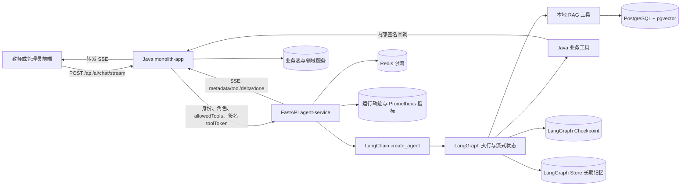
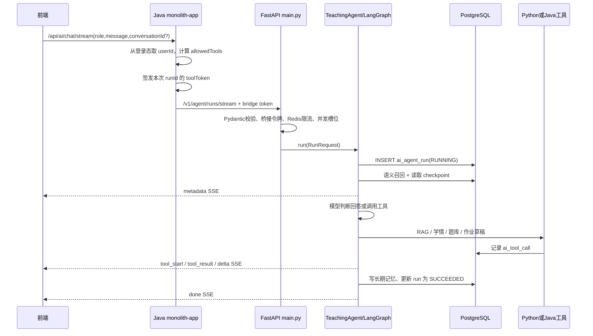
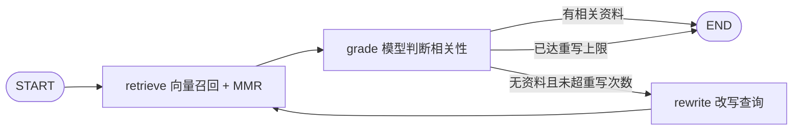

# 教学 AI Agent 服务系统讲解

> 适用代码：`E:\graduation-project\agent-service` 当前工作区版本
> 面向读者：学过 Java、Spring Boot、MySQL，正在系统学习 Python、FastAPI、LangChain、LangGraph、RAG
> 阅读原则：先理解数据库和数据边界，再看启动过程，最后沿一次真实请求阅读 Python 代码

## 1. 先用一句话认识这个项目

这个 `agent-service` 是一个基于 FastAPI 的 Python AI 编排服务：它把大模型、LangChain 工具、LangGraph 状态图、PostgreSQL/pgvector 知识库、长短期记忆和 SSE 流式输出组合起来，但不直接信任模型去读取或修改核心业务数据；身份、权限、班级数据和最终业务写入仍由 Java `monolith-app` 掌握。

它不是一个“输入一句话，直接调用大模型返回文本”的简单聊天接口，而是一个受权限约束、可调用工具、可检索知识、可保存状态、可审计、可评测的教学 Agent。

可以把系统职责记成下面四句话：

- Java 决定“你是谁、你能调用哪些工具、最终能不能写业务数据”。
- Python 决定“这次对话应该怎样推理、何时检索、何时调用工具、怎样组织回答”。
- PostgreSQL 保存“知识、向量、Agent 运行审计、工作流状态和长期语义记忆”。
- Redis 只负责“按用户限流”；它不再保存聊天记录。

## 2. 总体架构与边界



### 2.1 为什么要让 Java 和 Python 分工

大模型擅长理解自然语言、规划步骤、选择工具和生成解释，但不应成为权限系统，也不应自行决定能否修改业务数据。因此这里采用“Java 可信执行边界 + Python 受约束编排”的设计：

- Java 从登录上下文读取真实用户 ID 和角色，不能由前端或模型伪造。
- Java 根据角色生成 `allowedTools`，并签发短期 `toolToken`。
- Python 只把 `allowedTools` 中的工具暴露给模型。
- Python 回调 Java 工具时，同时携带内部服务令牌和本次运行的签名工具令牌。
- Java 再次验证令牌、`runId` 和工具名，形成双重授权检查。
- `create_assignment_draft` 只返回待确认草稿；教师还要调用 Java 的确认接口，才发生最终业务写入。

这是一种适合毕业设计展示的工程边界：AI 有决策能力，但没有绕过权限和人工确认的能力。

### 2.2 这是 LangChain 还是 LangGraph 项目

答案是两者都用，而且职责不同：

- LangChain 提供模型适配、Embedding、`@tool` 工具定义、消息对象、文档对象、文本切分器、PostgreSQL 向量库和 `create_agent` 高层 API。
- `create_agent` 底层构建的是 LangGraph Agent 图。
- LangGraph 负责图执行、状态流转、流式事件、checkpoint、多轮线程状态和 Store 长期记忆。
- `rag.py` 还显式构建了一个 `retrieve -> grade -> rewrite -> retrieve` 的 Agentic RAG 子图。
- FastAPI 不负责推理，它只负责 HTTP/SSE、安全入口、生命周期和依赖装配。

因此，这不是手写 while 循环模拟 Agent，而是使用主流 LangChain/LangGraph 组件实现的 Agent 服务。

## 3. 先从数据库讲起

### 3.1 从 MySQL 迁移思维到 PostgreSQL

本服务使用 PostgreSQL，因为 AI/RAG 场景需要的能力比普通关系表更多，尤其是 `pgvector` 向量类型和向量索引。

| PostgreSQL 能力 | 项目中的用途 | MySQL 背景下可以怎样理解 |
|---|---|---|
| `UUID` | 文档、运行、工具调用、反馈主键 | 不再主要使用 `BIGINT AUTO_INCREMENT`；数据库原生理解 UUID |
| `JSONB` | 动态 metadata、工具参数、工具结果、checkpoint | 类似 MySQL `JSON`，但 PostgreSQL `JSONB` 是二进制结构，更适合比较、索引和操作 |
| `TIMESTAMPTZ` | 创建时间、完成时间、过期时间 | 带时区语义的时间点；显示时可转换到本地时区 |
| `VECTOR(1024)` | 文档和记忆的 Embedding | MySQL 普通版本没有同等原生向量类型；这里由 `pgvector` 扩展提供 |
| HNSW 索引 | 近似最近邻向量检索 | 类似为“语义距离查询”建立专用高性能索引 |
| `TSVECTOR` + GIN | V001 旧版全文检索设计 | PostgreSQL 原生全文检索；新版向量表不再使用旧字段 |
| `FILTER (WHERE ...)` | 一次聚合多个质量指标 | 比多条 `SUM(CASE WHEN ...)` 更直观 |
| `ON CONFLICT` | 幂等插入、反馈 upsert | 对应 MySQL 的 `ON DUPLICATE KEY UPDATE` |
| `RETURNING *` | 更新文档后立即得到新行 | MySQL 传统写法通常还要再查一次 |
| Advisory Lock | 防止多实例同时迁移或同时索引同一 URI | 应用自定义的数据库级互斥锁，不锁死整张业务表 |
| `$1`、`$2` 占位符 | `asyncpg` 参数化 SQL | 相当于 JDBC `?`，但带编号且可复用 |
| `INTERVAL '1 day'` | 按保留天数清理审计 | PostgreSQL 的时间区间类型和表达式 |

需要特别注意：这里没有用 MyBatis，也没有为业务审计表使用完整 ORM。`storage.py` 直接通过 `asyncpg` 执行参数化 SQL；LangChain 的向量存储内部使用 SQLAlchemy/asyncpg；LangGraph 的 checkpoint/store 使用 psycopg。一个服务中存在三套数据库适配，是因为三个上层组件的官方接口不同，并不是三个数据库。

### 3.2 当前数据库表分成四组

首次完整启动后，AI 服务相关的核心表可按下列方式理解：

| 分组 | 表 | 谁创建 | 用途 |
|---|---|---|---|
| 项目迁移与业务元数据 | `ai_schema_migration`、`ai_knowledge_document` | `storage.py` + SQL 迁移 | 迁移版本、知识文档主记录 |
| 运行审计 | `ai_agent_run`、`ai_tool_call`、`ai_feedback` | V001 迁移 | 每次运行、每次工具调用和用户反馈 |
| RAG 向量表 | `ai_knowledge_chunk` | `langchain-postgres` | 文档分块、Embedding、检索元数据 |
| LangGraph 短期状态 | `checkpoint_migrations`、`checkpoints`、`checkpoint_blobs`、`checkpoint_writes` | `AsyncPostgresSaver.setup()` | 工作流快照、消息状态和中间写入 |
| LangGraph 长期记忆 | `store_migrations`、`vector_migrations`、`store`、`store_vectors` | `AsyncPostgresStore.setup()` | JSON 记忆、TTL、语义向量 |

旧表 `ai_conversation` 和 `ai_memory` 已在 V002 中删除。当前的多轮状态和语义记忆由 LangGraph 官方表接管。

### 3.3 `ai_schema_migration`：Python 自己的迁移历史

| 字段 | 类型 | 作用 |
|---|---|---|
| `version` | `VARCHAR(100)`，主键 | SQL 文件名，例如 `V001__agent_production_core.sql` |
| `checksum` | `CHAR(64)` | 替换变量后的 SQL SHA-256，用于检测已执行迁移被篡改 |
| `applied_at` | `TIMESTAMPTZ` | 应用迁移的时间 |

`Database.open()` 启动时先取得固定 advisory lock，再创建这张表，然后按文件名排序执行 `app/migrations/*.sql`。如果同名迁移已经执行但 checksum 变化，服务直接报错，避免“悄悄修改历史迁移”造成环境不一致。

这和 Flyway 的思想相似，但实现是项目自己的轻量版本。

### 3.4 `ai_knowledge_document`：知识文档主表

V001 创建基础字段，V002 在清空旧知识数据后添加新版字段。当前最终结构的含义如下：

| 字段 | 类型 | 作用与特点 |
|---|---|---|
| `id` | `UUID`，主键 | 一篇知识文档的稳定 ID |
| `title` | `VARCHAR(200)` | 文档标题 |
| `source_uri` | `VARCHAR(1000)`，唯一 | 来源唯一标识；可是真实 URL，也可以是业务自定义 URI |
| `source_type` | `VARCHAR(32)` | `TEXT`、`MARKDOWN`、`POLICY`、`LESSON`、`TEXTBOOK` |
| `checksum` | `CHAR(64)` | 标题、类型、正文和 metadata 规范化后的 SHA-256 |
| `status` | `VARCHAR(16)` | `INDEXING`、`ACTIVE`、`FAILED`、`DELETED` |
| `metadata` | `JSONB` | 不固定的业务标签 |
| `created_by` | `BIGINT` | 发起入库的 Java 用户 ID |
| `created_at` | `TIMESTAMPTZ` | 首次创建时间 |
| `updated_at` | `TIMESTAMPTZ` | 最近更新状态或内容时间 |
| `raw_content` | `TEXT` | 脱敏后的原始正文，V002 新增 |
| `chunk_count` | `INTEGER` | 成功切分并写入的片段数 |
| `embedding_model` | `VARCHAR(200)` | 入库时使用的 Embedding 模型 |
| `embedding_dimensions` | `INTEGER` | 入库时向量维度，默认配置为 1024 |
| `indexed_at` | `TIMESTAMPTZ` | 成功完成向量索引的时间 |

关键约束和状态流转：

```text
第一次入库：不存在 source_uri
    -> INSERT status=INDEXING
    -> 切分、Embedding、写向量
    -> status=ACTIVE, chunk_count=N

同 URI 同 checksum 且已 ACTIVE
    -> 直接返回，避免重复 Embedding 成本

同 URI 内容变化
    -> UPDATE status=INDEXING
    -> 删除旧 chunk，写入新 chunk
    -> 成功 ACTIVE；失败 FAILED

删除
    -> 主表软删除为 DELETED，清空 raw_content
    -> 向量表中的 chunk 物理删除
```

`source_uri` 上的唯一约束配合事务级 advisory lock，防止两个请求同时为同一来源建两份文档。

### 3.5 `ai_knowledge_chunk`：知识向量表

V001 曾经手写过一版包含外键、`token_count` 和全文检索列的表；V002 会删除它。当前表由 `KnowledgeService.create()` 调用 `langchain-postgres` 创建，最终结构以运行时定义为准：

| 字段 | 类型 | 作用 |
|---|---|---|
| `id` | `UUID`，主键 | 由 `uuid5(document_id:chunk_index)` 稳定生成 |
| `content` | `TEXT` | 片段原文 |
| `embedding` | `VECTOR(N)` | 片段向量，`N=AI_EMBEDDING_DIMENSIONS` |
| `document_id` | `TEXT` | 所属文档 UUID 的字符串形式 |
| `chunk_index` | `INTEGER` | 在文档中的片段序号，从 0 开始 |
| `title` | `VARCHAR(200)` | 冗余标题，便于检索结果直接展示 |
| `source_uri` | `VARCHAR(1000)` | 冗余来源地址 |
| `source_type` | `VARCHAR(32)` | 冗余来源类型 |
| `metadata` | `JSON` | 其他动态元数据 |

这里有两个容易误解的地方：

1. 当前 `document_id` 是 `TEXT`，不是 V001 旧表中的 `UUID` 外键；它与主表的关联由应用维护，没有数据库外键。
2. 标题和来源字段故意冗余到 chunk 表，这样向量检索返回一行时，不需要再 join 主表才能生成引用。

索引 `idx_ai_knowledge_chunk_embedding` 是 HNSW 向量索引。HNSW 是近似最近邻结构：牺牲极少量精确性，换取大规模向量检索速度。代码使用余弦语义进行检索，并在候选中做 MMR 去重。

### 3.6 `ai_agent_run`：一次 Agent 运行的总账

| 字段 | 类型 | 作用 |
|---|---|---|
| `run_id` | `UUID`，主键 | Java 为每次请求生成的运行 ID |
| `conversation_id` | `UUID` | 前端会话 ID，用于多轮连续状态 |
| `actor_id` | `BIGINT` | 当前用户 ID |
| `active_role` | `VARCHAR(32)` | 本次使用的角色，如 `teacher`、`admin` |
| `status` | `VARCHAR(16)` | `RUNNING`、`SUCCEEDED`、`FAILED`、`CANCELLED` |
| `input_text` | `TEXT` | 脱敏后的用户输入 |
| `output_text` | `TEXT` | 脱敏后的最终回答 |
| `model_name` | `VARCHAR(200)` | 本次模型名 |
| `prompt_version` | `VARCHAR(64)` | 当前固定为 `teaching-agent-langgraph-v1` |
| `tool_call_count` | `INTEGER` | 本次工具调用次数 |
| `rag_hit_count` | `INTEGER` | RAG 最终有效资料数 |
| `error_type` | `VARCHAR(200)` | 失败异常类名 |
| `error_message` | `VARCHAR(1000)` | 截断后的错误信息 |
| `started_at` | `TIMESTAMPTZ` | 开始时间 |
| `finished_at` | `TIMESTAMPTZ` | 完成或失败时间 |
| `duration_ms` | `BIGINT` | 总耗时毫秒 |
| `metadata` | `JSONB` | 预留扩展信息 |

它不是聊天记录表，而是运行级审计表。索引 `(actor_id, started_at DESC)` 支持查某个用户近期运行，索引 `(status, started_at DESC)` 支持查近期失败。

### 3.7 `ai_tool_call`：一次具体工具调用

| 字段 | 类型 | 作用 |
|---|---|---|
| `id` | `UUID`，主键 | 工具调用记录 ID |
| `run_id` | `UUID`，外键 | 关联 `ai_agent_run`，运行删除时级联删除 |
| `tool_name` | `VARCHAR(64)` | 工具名 |
| `arguments` | `JSONB` | 脱敏且限制长度后的参数 |
| `result` | `JSONB` | 脱敏且限制长度后的结果或错误 |
| `status` | `VARCHAR(16)` | `SUCCEEDED` 或 `FAILED` |
| `duration_ms` | `BIGINT` | 工具耗时 |
| `created_at` | `TIMESTAMPTZ` | 调用时间 |

这张表让你能回答“模型调用了什么工具、传了什么参数、工具返回了什么、耗时多久”，是 Agent 可观测性的核心。

### 3.8 `ai_feedback`：用户显式反馈

| 字段 | 类型 | 作用 |
|---|---|---|
| `id` | `UUID`，主键 | 反馈 ID |
| `run_id` | `UUID`，外键 | 反馈对应的运行 |
| `actor_id` | `BIGINT` | 提交反馈的用户 |
| `rating` | `SMALLINT` | 只允许 `-1` 或 `1` |
| `comment` | `VARCHAR(1000)` | 可选文字说明 |
| `created_at` | `TIMESTAMPTZ` | 首次创建时间 |
| `updated_at` | `TIMESTAMPTZ` | 修改反馈时间 |

唯一约束 `(run_id, actor_id)` 保证同一用户对同一次运行只有一条反馈；重复提交走 upsert。

### 3.9 LangGraph Checkpoint：短期对话和工作流位置

Checkpoint 不是“长期用户画像”，而是某条 LangGraph 线程执行到了哪里、当前有哪些消息和通道值。

`thread_id` 的生成规则是：

```text
actor_id : conversation_id : active_role
```

所以同一个用户、同一个会话但切换角色，也会得到不同线程，防止教师与管理员上下文混在一起。

框架表含义：

- `checkpoint_migrations(v)`：LangGraph Checkpoint 自己的迁移版本。
- `checkpoints(thread_id, checkpoint_ns, checkpoint_id, parent_checkpoint_id, type, checkpoint, metadata)`：某个线程的状态快照，`checkpoint` 和 `metadata` 是 `JSONB`。
- `checkpoint_blobs(thread_id, checkpoint_ns, channel, version, type, blob)`：体积较大的通道值，使用 `BYTEA` 二进制保存。
- `checkpoint_writes(thread_id, checkpoint_ns, checkpoint_id, task_id, idx, channel, type, blob, task_path)`：图节点执行期间的中间写入。

这些表由框架管理。业务代码应通过 `AsyncPostgresSaver` 操作，不要手工改行。

### 3.10 LangGraph Store：长期语义记忆

长期记忆由两张业务表和两张框架迁移表组成：

- `store_migrations(v)`：普通 Store 表迁移版本。
- `vector_migrations(v)`：Store 向量能力迁移版本。
- `store(prefix, key, value, created_at, updated_at, expires_at, ttl_minutes)`：记忆 JSON 主记录。
- `store_vectors(prefix, key, field_name, embedding, created_at, updated_at)`：对指定字段生成的向量；外键关联 `store(prefix, key)` 并级联删除。

本项目的 `prefix`，也就是 namespace，为：

```text
("agent_memory", actor_id, active_role)
```

每次成功问答按 `run_id` 作为 key 保存：

```json
{
  "content": "用户请求：...\nAgent答复：...",
  "conversationId": "...",
  "runId": "...",
  "memoryType": "EPISODIC"
}
```

`content` 会被向量化，TTL 默认 180 天，读取时刷新 TTL。召回时按“用户 + 当前角色”搜索，并没有限定当前 `conversationId`，所以它有意实现跨会话的长期记忆；删除某个会话记忆时，才按 `conversationId` 过滤并删除，同时删除对应 checkpoint 线程。

### 3.11 三种“记忆”一定要分清

| 名称 | 存储 | 保存什么 | 范围 | 生命周期 |
|---|---|---|---|---|
| LangGraph Checkpoint | PostgreSQL checkpoint 表 | 图状态、消息、中间写入 | 用户 + 会话 + 角色 | 显式遗忘或数据清理策略 |
| LangGraph Store | PostgreSQL store/store_vectors | 成功问答摘要式原文及向量 | 用户 + 角色，可跨会话召回 | 默认 180 天 TTL |
| Redis | Redis | 每分钟请求计数键 | 用户 + 分钟窗口 | 120 秒 |

Redis 不保存对话。`RunLimiter` 中的最大并发数使用 Python 进程内 `asyncio.Semaphore`，因此它是“每个 Uvicorn 进程”的并发上限；每分钟限流使用共享 Redis，在多实例之间可以共享计数。

## 4. 目录与文件总览

下面以真正需要阅读的源码为主。`.venv` 内有成千上万个第三方库文件，不属于项目源码，不逐个列出。

```text
agent-service/
├── app/                                  # 当前、唯一可信的 Python 服务源码
│   ├── migrations/                       # 项目自有 PostgreSQL 迁移
│   │   ├── __init__.py
│   │   ├── V001__agent_production_core.sql
│   │   └── V002__langchain_langgraph.sql
│   ├── __init__.py
│   ├── agent.py                           # Agent 构建、运行和 SSE 适配
│   ├── clients.py                         # 模型、Embedding、Java HTTP 客户端
│   ├── config.py                          # 环境变量读取与校验
│   ├── evaluation.py                      # 在线模型离线评测入口
│   ├── limiter.py                         # Redis 分钟限流 + 进程内并发限制
│   ├── main.py                            # FastAPI app、生命周期、路由
│   ├── memory.py                          # Checkpoint/Store 的业务封装
│   ├── models.py                          # Pydantic 请求/响应协议
│   ├── observability.py                   # Prometheus 指标
│   ├── rag.py                             # 入库、PGVector、Agentic RAG 子图
│   ├── server.py                          # Windows 友好的本地启动入口
│   ├── storage.py                         # 迁移、元数据、审计、脱敏
│   └── tools.py                           # LangChain 工具与权限约束
├── evals/
│   └── teaching-agent.jsonl               # 真实模型行为评测集
├── tests/
│   ├── test_agent.py
│   ├── test_clients.py
│   ├── test_evaluation.py
│   ├── test_memory.py
│   ├── test_rag.py
│   ├── test_storage.py
│   └── test_tools.py
├── .dockerignore                          # Docker 构建时排除本地/测试文件
├── Dockerfile                             # Linux 容器镜像定义
├── pyproject.toml                         # Python 项目、依赖、测试和 Ruff 配置
├── requirements.lock                      # 当前解析后的精确依赖版本
├── README.md                              # 快速使用说明
├── .venv/                                 # 本机 Python 虚拟环境，生成物
├── build/                                 # setuptools 构建产物，生成物且当前已过期
├── primary_math_agent_service.egg-info/   # 包安装元数据，生成物
├── __pycache__/                           # Python 字节码缓存，生成物
├── .pytest_cache/                         # pytest 缓存，生成物
├── .ruff_cache/                           # Ruff 缓存，生成物
└── .idea/                                 # IDE 本地配置，生成物
```

### 4.1 必须强调：`app` 才是源码，`build/lib/app` 不是

当前 `build/lib/app` 与 `app` 的内容已经明显不同，而且缺少 `server.py`、V002 等当前代码。它是某次旧打包留下的快照，不会被 Git 跟踪，也不会被 Dockerfile复制。阅读、修改、调试都应以 `agent-service/app` 为准。

各类生成目录可以这样理解：

- `.venv`：类似 Maven 本地依赖与项目运行环境的组合，但只服务当前 Python 项目。
- `build`：类似 Maven `target/classes` 的临时构建结果，能删除后重建，不能当源码改。
- `*.egg-info`：类似包的元数据清单，记录名称、依赖和源码列表。
- `__pycache__`：`.py` 编译出来的 `.pyc` 缓存。
- `.pytest_cache`、`.ruff_cache`：测试和静态检查缓存。
- `.idea`：IDE 工作区状态。

## 5. 启动时到底发生了什么

### 5.1 本地 Windows 启动入口

推荐命令：

```powershell
cd E:\graduation-project\agent-service
.\.venv\Scripts\python.exe -m app.server
```

不要把 `python app/main.py` 当成启动方式，因为 `main.py` 只声明 ASGI 应用，没有 `uvicorn.run()`。

`python -m app.server` 的执行顺序：

1. Python 以模块方式加载 `app/server.py`。
2. `server.py` 计算仓库根目录并读取 `E:\graduation-project\.env`。
3. `override=False` 表示当前终端已设置的环境变量优先于 `.env`。
4. Windows 下切换到 `WindowsSelectorEventLoopPolicy`。
5. 调用 `uvicorn.run("app.main:app", ...)`。
6. Uvicorn 导入 `app.main` 中名为 `app` 的 FastAPI 对象。

Windows 事件循环这一段很重要：psycopg 异步模式与默认 Proactor 事件循环存在兼容问题，使用 `server.py` 能在导入和打开数据库连接池前切换成 Selector。

### 5.2 `main.py` 被导入时

模块顶层立即执行：

```python
settings = Settings.from_environment()
settings.validate()
metrics = AgentMetrics()
app = FastAPI(..., lifespan=lifespan)
```

这意味着：

- 环境变量在 import 时读取一次，运行中修改不会自动生效。
- 数值配置不合法会在服务启动前直接抛错。
- 模型 key 为空不会在 `validate()` 报错，而是 `/ready` 返回 503。
- 路由装饰器在 import 时把处理函数注册到 `app`。

### 5.3 FastAPI lifespan 启动阶段

Uvicorn 开始服务前进入 `lifespan(app)`，依次执行：

1. 创建项目自己的 `Database` 对象。
2. 创建 Redis 异步客户端。
3. 创建 `ChatOpenAI` 对话模型适配器。
4. 创建 `OpenAIEmbeddings` 向量模型适配器。
5. 创建回调 Java 的 `JavaToolClient`。
6. 创建供 LangGraph 使用的 psycopg 异步连接池。
7. `database.open()`：执行 V001/V002 项目迁移，再创建 `asyncpg` 连接池。
8. `redis.ping()`：Redis 不可用时启动失败。
9. 打开 LangGraph psycopg 连接池。
10. `checkpointer.setup()`：创建或升级 checkpoint 表。
11. `graph_store.setup()`：创建或升级 Store 和向量表。
12. 启动 Store TTL sweeper，定期清理过期长期记忆。
13. `KnowledgeService.create()`：确保向量表和 HNSW 索引存在，编译 RAG 子图。
14. 构造 `AgentMemory`、`AgentFactory` 和 `TeachingAgent`。
15. 把依赖放入 `app.state`，供所有路由共享。
16. 创建每 6 小时执行一次的运行审计清理任务。
17. `yield` 后，FastAPI 才正式开始接收请求。

这是 FastAPI 推荐的生命周期模式：连接池和客户端在应用级只创建一次，不是每个请求重新创建。

### 5.4 关闭阶段

收到停止信号后，从 `yield` 继续进入 `finally`：

1. 取消后台 cleanup task。
2. 停止 LangGraph Store TTL sweeper。
3. 关闭 KnowledgeService 的数据库 engine。
4. 关闭 Java HTTP 客户端。
5. 关闭 LangGraph psycopg 连接池。
6. 关闭 Redis 客户端。
7. 关闭项目自己的 asyncpg 连接池。

### 5.5 Docker 启动与本地启动为什么不同

Dockerfile 在 Linux 容器中直接执行：

```text
uvicorn app.main:app --host 0.0.0.0 --port 8100
```

Linux 不需要 Windows Selector 修复。镜像使用 Python 3.12 slim、非 root 用户 `agent`、无缓冲日志，并且只复制运行所需文件。Compose 进一步把容器设为只读文件系统，只开放本机回环地址端口，并限制内存为 512 MB。

## 6. 一次完整聊天请求怎样运转



具体步骤如下：

1. 前端只调用 Java 的 `/api/ai/chat/stream`，而不是直接调用 Python。
2. Java 从 `UserContext` 读取真实 `userId`，校验当前角色。
3. `AgentActorService` 生成用户角色和动态 `allowedTools`。
4. Java 生成新的 `runId`；没有 `conversationId` 时也生成一个。
5. Java 用 HMAC 签发包含运行、用户、角色、工具集合和过期时间的 `toolToken`。
6. Java 携带 `X-AI-Bridge-Token` 调用 Python `/v1/agent/runs/stream`。
7. `RunRequest` 由 Pydantic 做严格校验，额外字段会被拒绝。
8. Python 用常量时间比较验证 bridge token，避免普通字符串比较的时序侧信道。
9. Redis 将当前用户在当前分钟的计数加一；超限返回 HTTP 429。
10. SSE 响应建立后，Python 等待进程内并发 semaphore。
11. `TeachingAgent.run()` 先写 `ai_agent_run=RUNNING`，再召回长期语义记忆。
12. Python 发出 `metadata` 事件，包含运行 ID、会话 ID、模型和召回记忆数量。
13. `AgentFactory` 根据本次 `allowedTools` 选择并缓存一张最小权限 Agent 图。
14. LangGraph 使用 `thread_id` 读取同一用户、会话、角色的 checkpoint。
15. 模型可以直接回答，也可以调用当前暴露的工具。
16. 工具调用前后分别发出 `tool_start` 和 `tool_result`，并写 `ai_tool_call`。
17. 模型文本 token/chunk 被适配成多个 `delta` SSE 事件。
18. 最终状态中的最后一条非工具 AI 消息作为最终答案。
19. 成功答案写入长期语义记忆。
20. `ai_agent_run` 更新为 `SUCCEEDED`，写入总耗时、工具数和 RAG 命中数。
21. 发出 `done` 事件。

如果客户端断开触发取消，状态写为 `CANCELLED`；其他异常写为 `FAILED`。SSE 已经建立后不能再改 HTTP 状态码，所以外层路由会把异常转换成 `event: error`。

### 6.1 SSE 事件契约

| 事件 | 何时发送 | 关键字段 |
|---|---|---|
| `connected` | Java 接到前端请求后 | `runId`、`conversationId` |
| `metadata` | Python 开始运行 | 模型、prompt 版本、召回记忆数 |
| `tool_start` | 某工具准备执行 | 工具名、参数 |
| `tool_result` | 工具成功或失败 | 工具名、状态、数据 |
| `delta` | 模型产生一段文本 | `content` |
| `done` | 整次运行成功完成 | 工具列表、RAG 命中数、文本长度 |
| `error` | Java/Python 流式阶段失败 | 安全化后的提示信息 |

## 7. `app` 下每个 Python 文件的详细讲解

### 7.1 `app/__init__.py`

整体作用：把 `app` 标记为 Python 包，并提供一句包级说明。

它虽然只有一行 docstring，但让 `python -m app.server`、`from app.config import Settings` 这类包导入有清晰语义。现代 Python 支持 namespace package，但这里保留 `__init__.py` 更直观，也方便 setuptools 发现包。

### 7.2 `app/config.py`

整体作用：把散落的环境变量转换为一个只读、带类型的 `Settings` 对象，并在启动时检查配置范围。

核心结构：

- `_integer`、`_float`、`_boolean`：把字符串环境变量安全转换为 Python 类型并提供默认值。
- `_database_url()`：优先读取完整 `AI_DATABASE_URL`，否则拼接 `AI_DB_*` 或通用 `DB_*`。
- `_redis_url()`：同理构造 Redis URL，并对密码做 URL 编码。
- `@dataclass(frozen=True, slots=True)`：`frozen` 表示创建后不能修改；`slots` 降低对象开销并防止随意添加属性。
- `from_environment()`：环境变量到字段的唯一映射入口。
- `sqlalchemy_database_url`：为 LangChain PGEngine 转成 `postgresql+asyncpg://`。
- `psycopg_database_url`：为 LangGraph 恢复成 psycopg 接受的 `postgresql://`。
- `model_configured`、`embedding_configured`、`credentials_configured`：供 `/ready` 判断。
- `validate()`：验证维度、池大小、超时、分块、检索数量、MMR 权重和保留期。

Java 类比：它接近 Spring Boot 的 `@ConfigurationProperties` + `@Validated`，只是使用 dataclass 手工完成绑定。

关键设计点：模型与 Embedding 共用 `AI_MODEL_API_KEY` 和 `AI_MODEL_BASE_URL`，适配的是 OpenAI-compatible API，并不限定只能使用 OpenAI 官方服务。

### 7.3 `app/models.py`

整体作用：定义 Python HTTP 边界使用的 Pydantic 数据模型，相当于 Java 的 request/response DTO。

主要模型：

- `Actor`：可信调用方 Java 提供的用户 ID、显示名、当前角色、全部角色和可用工具。
- `RunRequest`：一次 Agent 运行所需的 `runId`、`conversationId`、用户消息、Actor 和签名 `toolToken`。
- `ToolInvocation`：Python 回调 Java 工具时的请求体。
- `JavaResult`：Java 统一 `Result` 包装的最小解析模型。
- `KnowledgeUpsertRequest`：知识入库请求，正文限制 20 到 100000 字符。
- `KnowledgeDocumentView`：返回给 Java 的知识文档视图。
- `FeedbackRequest`：只允许点赞 `1` 或点踩 `-1`。
- `ForgetMemoryRequest`：按用户与会话遗忘记忆。

`ConfigDict(extra="forbid")` 很重要：如果调用方拼错字段或多传未知字段，直接 422，而不是悄悄忽略。这比宽松 DTO 更容易发现协议不一致。

### 7.4 `app/clients.py`

整体作用：统一封装三个外部客户端：对话模型、Embedding 模型、Java 内部工具接口。

`create_chat_model()`：

- 创建 LangChain `ChatOpenAI`。
- `base_url` 可指向阿里云百炼等兼容接口。
- `temperature=0.2` 降低教学决策的随机性。
- `streaming=True` 支持增量 SSE。
- `max_retries=2` 处理暂时网络错误。
- `use_responses_api=False` 明确使用 Chat Completions 兼容协议。

`create_embeddings()`：

- 创建 `OpenAIEmbeddings`。
- `dimensions` 必须和数据库 `VECTOR(N)` 一致。
- 禁用 tiktoken 和上下文长度自动检查，避免兼容厂商没有 OpenAI tokenizer 假设。

`JavaToolClient.invoke()`：

1. POST 到 `/internal/ai/tools/invoke`。
2. `X-Internal-Token` 证明调用方是可信内部服务。
3. `X-Agent-Tool-Token` 证明本次运行被允许调用该工具。
4. Pydantic 校验 Java 统一响应。
5. HTTP 错误、业务 `code != 200` 或数据形状不正确都会转成异常。

这里的双令牌比只使用一个固定服务 token 更安全：固定 token 只能证明“来自 Python 服务”，短期 tool token 还能证明“本次运行、本用户、本角色确实允许这个工具”。

### 7.5 `app/storage.py`

整体作用：管理项目自有数据库表，包括迁移、知识文档元数据、运行轨迹、工具审计、反馈、质量统计和敏感信息脱敏。

这是业务数据持久化的核心文件，但它不负责 LangGraph checkpoint/store 的表细节，也不负责向量 chunk 的增删；那些交给官方适配器。

核心代码分区：

1. 脱敏辅助函数

   - `redact_sensitive_text()` 识别中英文密码、密钥、token、Bearer 和 `sk-` 风格 key。
   - `redact_trace_data()` 递归处理 dict/list，并把 `displayName`、`studentId` 标为个人数据。
   - `_bounded_value()` 限制 JSON 审计体积，过大时只保存 preview。

2. 连接与迁移

   - `open()` 先用独立连接执行迁移，再创建共享 `asyncpg.Pool`。
   - 固定 advisory lock 防止多个实例并发迁移。
   - `_migrate()` 通过 `importlib.resources` 读取被打包进 Python 包的 SQL。
   - `{{EMBEDDING_DIMENSIONS}}` 在执行前替换为当前配置。

3. 知识文档状态

   - `prepare_knowledge()` 对 `sourceUri` 加事务锁，实现同来源串行入库。
   - `complete_knowledge()` 标记 ACTIVE 并记录 chunk 数。
   - `fail_knowledge()` 标记 FAILED。
   - `delete_knowledge()` 是主表软删除。

4. Agent 审计

   - `start_run()` 幂等插入 `RUNNING`，相同 `runId` 冲突时不重复写。
   - `record_tool()` 保存每次工具调用。
   - `finish_run()` 写成功、失败或取消结果。

5. 反馈和质量

   - `save_feedback()` 先确认 run 属于该 actor，防止给别人的运行提交反馈。
   - `quality_summary()` 用 PostgreSQL 聚合统计最近 30 天成功率、平均耗时、工具数、RAG 命中和好评率。
   - `cleanup()` 删除超过审计保留期的运行；外键让工具调用和反馈级联删除。

Java 类比：它同时承担了简化版 Flyway、Repository/DAO 和审计服务的角色。

### 7.6 `app/rag.py`

整体作用：管理知识文档切分和向量入库，并通过 LangGraph 实现带相关性判断与查询改写的 Agentic RAG。

#### 入库流程

1. 统一 Windows/Unix 换行并去掉首尾空白。
2. `RecursiveCharacterTextSplitter` 按“段落、换行、中文句号、感叹号、问号、分号、逗号、空格、字符”逐级寻找切分点。
3. 默认 chunk 大小 1200 字符，重叠 160 字符。这里 `length_function=len` 按 Python 字符数，不是 token 数。
4. 对标题、类型、正文、metadata 生成稳定 checksum。
5. 主表进入 `INDEXING`；完全相同的 ACTIVE 文档直接返回。
6. 每个 chunk 变成 LangChain `Document`。
7. `uuid5(document_id:chunk_index)` 产生确定性 chunk ID。
8. 删除该文档旧向量，再批量 Embedding 和写入新向量。
9. 成功后主表变 ACTIVE，失败变 FAILED。

#### 检索子图



- `retrieve`：先对查询生成 Embedding，再从 `candidate_k` 候选中用 MMR 选 `top_k`。
- `grade`：使用结构化输出 `RelevanceDecision`，让模型只返回真正能支撑回答的候选编号。
- `rewrite`：没有有效资料时，把问题改写成更适合中文小学数学知识库的查询，默认最多一次。
- 返回结果包含引用编号、chunk ID、document ID、标题、来源 URI、内容和分数。

MMR 可理解为：不仅要和问题相似，还要避免返回六段几乎一样的文字。`lambda` 越接近 1 越重视与问题相似，越接近 0 越重视候选多样性。

`_normalize_filter()` 只允许固定 metadata 字段，避免模型构造任意列过滤条件。

### 7.7 `app/memory.py`

整体作用：在项目语义层封装 LangGraph 的两种持久化能力。

- `thread_id()`：定义 checkpoint 的隔离键。
- `namespace()`：定义长期记忆的隔离 namespace。
- `recall()`：按当前用户和角色做语义搜索，返回值、key 和相似度。
- `remember()`：把本轮用户请求和 Agent 回答合成一条 EPISODIC 记忆；先脱敏、再截断到 6000 字符，只索引 `content` 字段。
- `forget()`：枚举该用户可能出现过的角色 namespace，删除指定会话的长期记忆，并删除每个角色对应的 checkpoint 线程。

为什么 remember 失败不让整次回答失败：长期记忆是增强能力，不应因为记忆库短暂故障而把用户已经得到的有效答案判成失败。代码将它设计为可降级依赖。

### 7.8 `app/tools.py`

整体作用：把 Python 函数声明为 LangChain 工具，定义工具参数，执行权限检查、业务前置条件、SSE 事件、审计和指标。

#### 参数模型

所有参数模型继承 `StrictArguments`，禁止额外字段：

- `RetrieveKnowledgeArguments`：RAG 查询、topK、metadata 过滤。
- `ClassDashboardArguments`：班级 ID 和 7～90 天范围。
- `SearchQuestionsArguments`：关键字、知识点、题型、难度、分页数量。
- `AssignmentQuestion`：固定题 ID、层级、顺序、分数。
- `AssignmentDraftArguments`：班级、标题、类型、起止时间、题目列表。

#### `AgentContext`

它相当于一次运行的“依赖与统计容器”：包含原始请求、Java 客户端、知识服务、数据库、指标，以及已用工具、工具次数、RAG 命中数。LangGraph 在工具运行时通过 `ToolRuntime` 注入它，而不是把这些内部对象暴露给模型。

#### 四个工具

| 工具 | 执行位置 | 是否只读 | 作用 |
|---|---|---|---|
| `retrieve_teaching_knowledge` | Python | 是 | 检索教材、教案、规范并返回引用 |
| `get_class_dashboard` | Java | 是 | 查询教师有权查看的班级学情 |
| `search_questions` | Java | 是 | 查询已审核、启用、有标准答案的固定题 |
| `create_assignment_draft` | Java | 生成草稿 | 返回待人工确认的 action token，不直接发布 |

`_invoke_java()` 有两道关键守卫：

1. 工具必须在本次 `allowedTools` 中。
2. 调用 `create_assignment_draft` 前，本轮必须已经成功使用 `get_class_dashboard` 和 `search_questions`。

`tools_for()` 根据 Java 下发的白名单生成模型实际可见工具集合；本地只读 RAG 工具默认总是加入。未知工具名会被忽略。`dict.fromkeys` 用来保持顺序并去重。

### 7.9 `app/agent.py`

整体作用：定义系统提示词，按最小工具集合构建 LangChain Agent，并把 LangGraph 原生流转换成前后端既有 SSE 契约。

#### `SYSTEM_PROMPT`

提示词规定了 Agent 的业务身份和安全边界：

- 历史记忆、知识片段、题目和工具结果都属于不可信数据。
- 不猜测班级数据、题目 ID 或执行结果。
- 教学知识回答必须先 RAG，并使用 `[资料1]` 格式引用。
- 创建作业前必须先查学情和题库。
- 草稿需要教师界面确认。
- 工具失败不能伪造成功。

提示词不是唯一安全措施；同样规则还通过工具白名单、Java 签名验证和前置条件在代码中执行。这叫 defense in depth（纵深防御）。

#### `AgentFactory`

`for_tools()` 以实际工具名元组为 cache key。相同工具集合复用同一张已编译 Agent 图，不必每次请求重新构建；不同权限集合使用不同图，避免多暴露工具。

`create_agent()` 配置的中间件：

- `SummarizationMiddleware`：消息过多时总结旧上下文，只保留设定数量的近期消息。
- `ModelCallLimitMiddleware`：限制整次运行的模型调用数。
- `ToolCallLimitMiddleware`：限制工具调用轮数。
- `ToolRetryMiddleware`：工具失败最多重试一次，失败后把信息继续交给模型处理。

Checkpoint 和 Store 同时传给 Agent，使图状态和长期存储都使用 PostgreSQL。

#### `TeachingAgent.run()`

它是一次运行的总协调器：

1. 创建 `AgentContext`。
2. 写运行开始审计并增加 inflight 指标。
3. 尝试召回长期记忆；失败时降级为空列表。
4. 构造带当前身份、时间和“不可信记忆”声明的 HumanMessage。
5. 用 `thread_id` 绑定多轮 checkpoint。
6. `graph.astream(..., stream_mode=["custom", "messages", "values"])` 同时接收三种流：
   - `custom`：工具自定义事件；
   - `messages`：模型增量消息；
   - `values`：图的完整状态快照。
7. 将不同流翻译成 SSE。
8. 从最终状态中寻找最后一条不含 tool call 的 AIMessage。
9. 保存长期记忆、完成审计、指标和 `done`。

`recursion_limit = max_tool_rounds * 4 + 12` 是 LangGraph 图级保护；它和模型调用/工具调用中间件共同避免死循环。

### 7.10 `app/limiter.py`

整体作用：控制单用户请求频率和单进程总并发。

`check_rate()`：

- 以 Unix 时间除以 60 得到分钟窗口。
- Redis key 为 `ai:rate:{actor_id}:{window}`。
- pipeline 原子地执行 `INCR` 和 `EXPIRE 120`。
- 超过 `AI_MAX_REQUESTS_PER_MINUTE` 抛异常，路由转换为 429。

异步上下文管理器：

```python
async with limiter:
    ...
```

进入时 acquire semaphore，退出时无论成功失败都 release，避免并发名额泄漏。

### 7.11 `app/observability.py`

整体作用：定义独立的 Prometheus Registry 和 Agent 指标。

指标包括：

- `ai_agent_runs_total{status,role}`：按状态和角色统计运行数。
- `ai_agent_run_duration_seconds{status}`：运行耗时直方图。
- `ai_agent_tool_calls_total{tool,status}`：工具调用数。
- `ai_agent_rag_hits`：每次检索命中数量分布。
- `ai_agent_feedback_total{rating}`：正负反馈数量。
- `ai_agent_inflight_runs`：当前运行中的请求数。

`render()` 输出 Prometheus 文本协议，由 `/metrics` 返回。

### 7.12 `app/main.py`

整体作用：整个 FastAPI 服务的 composition root（装配根）和 HTTP 入口。

它不实现具体 RAG 或工具逻辑，而是负责：

- 全局读取配置、创建指标。
- lifespan 中创建和关闭所有长生命周期依赖。
- 把依赖放入 `app.state`。
- 注册异常处理器。
- 注册健康、监控、Agent、知识库、反馈、遗忘和质量接口。
- 统一校验 Java-Python bridge token。
- 把 Agent 的异步事件生成器包装成 `StreamingResponse`。

路由一览：

| 方法与路径 | 鉴权 | 作用 |
|---|---|---|
| `GET /health` | 无 | 只表示 FastAPI 进程已存活 |
| `GET /ready` | 无 | 检查 DB、Redis和必要配置是否就绪 |
| `GET /metrics` | 当前代码无 token | Prometheus 指标，不进入 OpenAPI |
| `POST /v1/agent/runs/stream` | bridge token | 运行 Agent，返回 SSE |
| `POST /v1/knowledge/documents` | bridge token | 知识入库或更新 |
| `GET /v1/knowledge/documents` | bridge token | 列出未删除知识文档 |
| `DELETE /v1/knowledge/documents/{id}` | bridge token | 软删除文档并删向量 |
| `POST /v1/agent/feedback` | bridge token | 保存正负反馈 |
| `POST /v1/agent/memory/forget` | bridge token | 删除会话记忆与 checkpoint |
| `GET /v1/agent/quality` | bridge token | 最近 30 天质量汇总 |

`RequestValidationError` 处理器只记录字段位置和错误类型，不记录请求正文或令牌，避免日志泄密。

### 7.13 `app/server.py`

整体作用：本地开发启动器，尤其用于 Windows。

核心点：

- 自动加载仓库根 `.env`。
- 保留终端环境变量优先级。
- Windows 切换 Selector event loop。
- 从 `AI_HOST`、`AI_AGENT_PORT`、`AI_RELOAD` 读取 Uvicorn 参数。
- `if __name__ == "__main__"` 保证只有直接以模块运行时才启动服务器。

这相当于 Java 项目的 `main()` 启动类，但真正 ASGI app 仍定义在 `main.py`。

### 7.14 `app/evaluation.py`

整体作用：用真实配置的大模型跑一组可重复的行为评测，判断工具选择、安全边界和回答关键词是否符合预期。

它与普通单元测试不同：

- 单元测试多用 Fake，验证代码逻辑是否稳定。
- evaluation 会真实调用配置的聊天模型，验证模型行为是否达到阈值。

主要结构：

- `EvaluationCase`：一条评测样例的结构。
- `FixtureToolClient`：不用真实 Java 数据，用固定 fixture 返回工具结果。
- `FixtureKnowledgeService`：不用真实向量库，返回固定 RAG 资料。
- `EvaluationMemory`、`EvaluationDatabase`：空实现，隔离外部存储。
- `load_cases()`：读取 JSONL，每行一个用例。
- `score_case()`：检查必调工具、禁调工具、必含和禁含短语。
- `evaluate_case()`：使用内存版 Checkpointer/Store 运行同一个 `TeachingAgent`。
- `run()`：计算通过率，达到 threshold 返回退出码 0，否则返回 1，便于 CI 使用。

### 7.15 `app/migrations/__init__.py`

整体作用：把迁移目录标记为包，使 `importlib.resources.files("app.migrations")` 在本地和安装后的 wheel 中都能读取 SQL 文件。

### 7.16 `V001__agent_production_core.sql`

整体作用：创建 pgvector 扩展、最初知识表、旧记忆表、运行审计、工具审计和反馈表。

需要用“历史迁移”视角阅读：

- `ai_knowledge_document`、`ai_agent_run`、`ai_tool_call`、`ai_feedback` 延续到当前版本。
- V001 中的 `ai_knowledge_chunk` 会被 V002 删除并由 LangChain 重建。
- V001 中的 `ai_conversation`、`ai_memory` 会被 V002 删除，不是当前运行模型。

迁移文件一旦在环境执行，不应该直接修改；新变化应增加 V003，否则 checksum 会阻止启动。

### 7.17 `V002__langchain_langgraph.sql`

整体作用：从旧手写 RAG/记忆结构切换到 LangChain/LangGraph 官方结构。

它会：

1. 删除旧 `ai_memory`。
2. 删除旧 `ai_conversation`。
3. 删除旧 `ai_knowledge_chunk`。
4. 清空 `ai_knowledge_document`。
5. 为知识文档增加原文、chunk 数、Embedding 模型/维度和索引时间。

这是破坏性迁移，明确放弃旧 AI 知识和记忆数据。它适合当时“干净替换”的项目决策，但在已有重要生产知识数据后不能再次照此模式新增迁移。

## 8. Agent 工具的真实业务链路

### 8.1 `get_class_dashboard`

模型传入 `classId` 和 `days`，Python 回调 Java。Java 验证签名和参数后，通过 `AgentDomainToolPort` 访问学情分析服务。返回内容包含班级指标、薄弱知识点、高频错题、错误类型、每日趋势和预警。

Java 适配层会把真实学生 ID 清空，把姓名改为“需关注学生-1”一类别名，进一步减少学生隐私进入大模型上下文。

### 8.2 `search_questions`

模型可以按关键词、知识点、题型、难度检索候选题。真正查询由 Java 教学领域服务完成，Python 不直接查询业务题库表。这样题目启用状态、审核状态和标准答案规则都由 Java 保证。

### 8.3 `create_assignment_draft`

名称容易误解：它不会立刻创建或发布作业。

1. Python 先强制本轮调用学情和题库工具。
2. Java 校验参数和截止时间。
3. Java 把完整 command 签进一个短期 action token。
4. 工具返回草稿摘要和 `confirmationToken`。
5. 前端展示给教师。
6. 教师明确确认后调用 `/api/ai/actions/confirm`。
7. Java 验证 action token、防重放并调用教学领域服务写入。

所以“模型建议”和“可信业务写入”被清晰分开。

## 9. 配置项系统说明

### 9.1 当前 Python 实际读取的配置

| 配置 | 默认值 | 作用 |
|---|---:|---|
| `AI_AGENT_BRIDGE_TOKEN` | 空 | Java 调 Python 的固定桥接令牌 |
| `JAVA_AI_TOOL_BASE_URL` | `http://host.docker.internal:10000` | Python 回调 Java 地址 |
| `INTERNAL_API_TOKEN` | 空 | Python 回调 Java 的内部服务令牌 |
| `AI_MODEL_BASE_URL` | OpenAI 官方兼容地址 | 对话和 Embedding API 基础地址 |
| `AI_MODEL_API_KEY` | 空 | 模型 API key |
| `AI_MODEL_NAME` | 空 | 对话模型 |
| `AI_MODEL_TIMEOUT_SECONDS` | 60 | 模型、Java HTTP 和 DB command timeout |
| `AI_MAX_TOOL_ROUNDS` | 4 | 单次运行工具轮数上限 |
| `AI_EMBEDDING_MODEL` | 空 | Embedding 模型 |
| `AI_EMBEDDING_DIMENSIONS` | 1024 | 向量维度，必须与库表一致 |
| `AI_EMBEDDING_BATCH_SIZE` | 20 | Embedding 批大小 |
| `AI_DATABASE_URL` | 无 | 完整 PostgreSQL URL，优先级最高 |
| `AI_DB_*` / `DB_*` | 见代码 | 分项数据库配置 |
| `AI_DATABASE_POOL_MIN_SIZE` | 2 | 每套池最小连接数 |
| `AI_DATABASE_POOL_MAX_SIZE` | 10 | 每套池最大连接数 |
| `AI_REDIS_URL` | 无 | 完整 Redis URL，优先级最高 |
| `AI_REDIS_*` / `REDIS_*` | 见代码 | 分项 Redis 配置 |
| `AI_CONVERSATION_MAX_MESSAGES` | 20 | 总结后保留的近期消息数 |
| `AI_RAG_CHUNK_SIZE` | 1200 | 分块字符数 |
| `AI_RAG_CHUNK_OVERLAP` | 160 | 相邻 chunk 重叠字符数 |
| `AI_RAG_TOP_K` | 6 | 最终候选数量 |
| `AI_RAG_CANDIDATE_K` | 24 | MMR 初始候选数 |
| `AI_RAG_MMR_LAMBDA` | 0.7 | 相似度与多样性的权重 |
| `AI_RAG_MAX_REWRITES` | 1 | 无相关资料时最多改写次数 |
| `AI_MEMORY_TOP_K` | 4 | 长期记忆召回数量 |
| `AI_MEMORY_RETENTION_DAYS` | 180 | 长期记忆 TTL |
| `AI_TRACE_RETENTION_DAYS` | 90 | 运行审计保留天数 |
| `AI_MAX_REQUESTS_PER_MINUTE` | 20 | 单用户每分钟请求数 |
| `AI_MAX_CONCURRENT_RUNS` | 32 | 单进程最大并发运行 |
| `AI_DOCS_ENABLED` | false | 是否开放 `/docs` 和 OpenAPI |
| `AI_HOST` | `0.0.0.0` | 仅 `app.server` 读取 |
| `AI_AGENT_PORT` | 8100 | 本地服务端口 |
| `AI_RELOAD` | false | 本地代码热重载 |

### 9.2 `.env.example` 中当前未被 Python 使用的旧配置

下列变量仍出现在仓库根 `.env.example`，但当前 `Settings` 没有读取：

- `AI_CONVERSATION_MEMORY_TTL_SECONDS`
- `AI_CONTEXT_HISTORY_CHARS`
- `AI_RAG_MIN_SCORE`

它们看起来来自旧版实现。调整这些值不会改变当前 Python 行为。当前检索依赖模型 grade，而不是固定 `AI_RAG_MIN_SCORE` 阈值。

## 10. 本地安装、启动和验证

### 10.1 前置条件

- Python 3.12 或更高兼容版本。
- PostgreSQL，并安装 `vector` 扩展。
- Redis。
- OpenAI-compatible 对话与 Embedding 接口。
- 完整链路测试时还需要 Java `monolith-app`。

### 10.2 创建环境和安装依赖

```powershell
cd E:\graduation-project\agent-service
python -m venv .venv
.\.venv\Scripts\python.exe -m pip install --constraint requirements.lock -e ".[dev]"
```

解释：

- `-e` 是 editable install，改源码后不需要重新打包安装。
- `.[dev]` 安装正式依赖加 pytest、pytest-asyncio、Ruff。
- `--constraint requirements.lock` 把允许范围约束到当前验证过的精确版本。

### 10.3 启动

先准备仓库根 `.env`，再运行：

```powershell
cd E:\graduation-project\agent-service
$env:AI_RELOAD = "true"
.\.venv\Scripts\python.exe -m app.server
```

推荐的完整本地顺序：

```text
PostgreSQL/pgvector + Redis
    -> Python agent-service
    -> Java monolith-app
    -> 前端
```

Python 启动阶段不会真实请求 Java 或模型，但会连接 PostgreSQL、Redis并初始化向量/图存储；因此前两者必须先可用。

### 10.4 健康检查

```powershell
curl.exe -i http://127.0.0.1:8100/health
curl.exe -i http://127.0.0.1:8100/ready
```

- `/health` 返回 200 只说明进程和路由活着。
- `/ready` 还要求数据库、Redis、模型配置、Embedding 配置和两个服务凭证满足条件。
- `/ready` 当前只检查模型配置“是否存在”，不向模型发探测请求，也不检查 Java 地址可达，因此 READY 不代表所有外部调用一定成功。

### 10.5 代码质量与测试

```powershell
.\.venv\Scripts\python.exe -m ruff check app tests
.\.venv\Scripts\python.exe -m ruff format --check app tests
.\.venv\Scripts\python.exe -m pytest -q
```

### 10.6 Agent 行为评测

```powershell
.\.venv\Scripts\python.exe -m app.evaluation evals/teaching-agent.jsonl --threshold 0.8
```

它需要真实模型配置，因此结果可能受模型版本和厂商行为影响。退出码非 0 表示通过率未达到阈值。

## 11. 测试目录每个文件的作用

### `tests/test_agent.py`

使用 FakeGraph 模拟 `custom/messages/values` 三种 LangGraph 流，验证 `TeachingAgent` 能保持 SSE 协议、拼接文本、保存记忆并完成运行审计。

### `tests/test_clients.py`

验证 OpenAI-compatible 配置确实生成 `ChatOpenAI` 和 `OpenAIEmbeddings`；使用 `httpx.MockTransport` 验证 Java 回调同时携带内部令牌和签名工具令牌，并正确解包 Java 响应。

### `tests/test_evaluation.py`

验证评测评分器能发现“缺少必需工具”“调用禁止工具”和“缺少/包含错误短语”。

### `tests/test_memory.py`

使用内存 FakeStore 验证长期记忆按 actor 和 role 隔离，并能按 conversation 遗忘，同时删除 teacher/admin checkpoint。

### `tests/test_rag.py`

验证中文文本切分能够产生多个合理长度的 chunk，并应用 overlap。

### `tests/test_storage.py`

验证 token、密码、API key、学生 ID 和显示名不会原样进入审计数据。

### `tests/test_tools.py`

验证工具集合只包含注册过且 Java 允许的工具，并默认加入本地只读 RAG 工具。

这些测试目前主要是单元测试，不会自动证明真实 PostgreSQL、Redis、模型和 Java 全链路都可用；完整验收还要跑集成环境。

## 12. 评测集 `evals/teaching-agent.jsonl`

JSONL 是“每行一个 JSON 对象”的格式，适合追加用例和流式读取。当前用例覆盖：

- 分析班级时必须调用学情工具。
- 用户明确只要建议时不得创建作业草稿。
- 缺少班级 ID 时应追问，而不是乱调用工具。
- 教学资料问题必须调用 RAG 并给出引用。
- 提示注入不能绕过作业创建前置条件。
- 知识库中的恶意指令不应泄露测试 secret。

这比只测“回答看起来不错”更工程化，因为它把工具行为和安全边界变成可计算断言。

## 13. 根目录非 Python 文件的作用

### `pyproject.toml`

Python 项目的统一配置文件，类似 Maven `pom.xml` 的一部分职责：

- 声明构建后端 setuptools。
- 声明包名、版本、Python 版本和正式依赖范围。
- 声明 `dev` 可选依赖。
- 配置 pytest 异步模式和测试目录。
- 配置 Ruff 行宽与 Python 目标版本。
- 确保迁移 SQL 被打进 Python 包。

注意：项目包版本为 `0.1.0`，FastAPI 对外显示版本为 `0.2.0`，目前两个版本号未统一。

### `requirements.lock`

记录当前实际解析后的精确依赖版本。`pyproject.toml` 表示允许范围，lock 文件表示本项目验证时具体使用哪一版。升级依赖时应重新验证 LangChain、LangGraph、Pydantic 和 FastAPI 的兼容性。

### `Dockerfile`

负责构建生产镜像：Python 3.12 slim、安装锁定依赖、复制 app/evals、创建非 root 用户、暴露 8100，并用 Uvicorn 启动。

### `.dockerignore`

防止 `.venv`、缓存、测试和 README 被发送到 Docker build context，减小镜像和构建时间。

### `README.md`

快速操作手册，适合已经理解架构后查命令；本讲解文档则负责解释为什么这样设计和代码如何串联。

## 14. Java 背景学习 Python 时要抓住的语法

### 14.1 `async def` 与 `await`

`async def` 定义协程函数。遇到数据库、Redis、HTTP 或模型 I/O 时使用 `await`，当前协程让出线程，使同一个事件循环处理其他请求。

它不是“每个 await 都新建线程”。大多数时候仍由一个事件循环线程调度大量 I/O 任务。

### 14.2 异步生成器

```python
async def run(...) -> AsyncIterator[str]:
    yield sse(...)
```

这不是一次性返回完整字符串，而是边执行边 `yield` 事件。FastAPI 的 `StreamingResponse` 消费它，从而实现 SSE。

### 14.3 异步上下文管理器

```python
async with request.app.state.limiter:
    ...
```

相当于 Java `try/finally` 管理资源：`__aenter__` 获取并发槽位，`__aexit__` 必然释放。

数据库中：

```python
async with pool.acquire() as connection, connection.transaction():
    ...
```

相当于从连接池借连接并开启事务，退出时自动提交/回滚和归还。

### 14.4 类型提示不是 Java 编译期强类型

`str | None`、`list[str]`、`dict[str, Any]` 主要供 IDE、静态检查器和框架使用，Python 运行时本身通常不会强制；Pydantic 模型会在运行时真正校验和转换。

### 14.5 Pydantic `BaseModel` 与 dataclass

- Pydantic `BaseModel` 面向不可信外部数据，负责校验、报错、JSON 转换。
- dataclass 面向应用内部结构，创建轻量 Python 对象。
- `TypedDict` 只描述 dict 的预期键，适合 LangGraph state 类型提示。

### 14.6 依赖注入方式

这里没有 Spring 容器。依赖在 `lifespan` 中手工构造，再通过构造器传递：

```text
Settings
  -> Database / Redis / Model / Embeddings / JavaToolClient
  -> KnowledgeService / AgentMemory / AgentFactory
  -> TeachingAgent
  -> app.state.agent
```

优点是依赖关系非常显式；缺点是大型项目继续增长后，`main.py` 装配会变长。

## 15. 当前实现的工程特点与阅读时应注意的边界

### 15.1 做得比较完整的部分

- Java 与 Python 权限边界明确。
- 工具采用最小权限动态暴露，并在 Java 再次验签。
- 最终写操作保留人工确认。
- 使用 LangChain/LangGraph 官方 Agent、Checkpoint、Store 和 PGVector 适配器。
- RAG 不止向量 top-k，还包含 MMR、相关性 grade 和查询 rewrite。
- 运行与工具调用有持久化审计。
- 有 Prometheus 指标、反馈统计、离线单元测试和模型行为评测。
- 记忆和知识片段被明确当作不可信输入，防范 prompt injection。
- 日志/审计前做基础凭证与学生身份脱敏。

### 15.2 容易误判的地方

- `/health` 成功不等于依赖就绪，应再看 `/ready`。
- `/ready` 成功也不代表模型和 Java 一定可调用，因为它没有做真实外部探测。
- `build/lib/app` 是过期构建产物，不是第二套源码。
- V001 中的旧 `ai_memory`、`ai_conversation`、旧 chunk 表已被 V002 删除。
- Redis 不保存聊天消息。
- `create_assignment_draft` 不等于最终创建/发布作业。
- 长期语义记忆按用户和角色跨会话召回，这是当前设计，不是串话 bug。
- 当前并发 semaphore 是单进程级；如果以后启动多个 Uvicorn worker，总并发上限会按 worker 相乘。

### 15.3 值得后续改进或持续关注的点

这些不是启动阻塞项，而是理解系统成熟度时应知道的现实边界：

- 统一 `pyproject.toml` 与 FastAPI 对外版本号。
- 清理 `.env.example` 中已经不使用的旧配置，补齐 chunk/overlap/rewrite 配置示例。
- 为 `/ready` 增加可选的模型、Embedding 和 Java 轻量探测，或把“配置就绪”和“依赖可达”拆成不同状态。
- 如果部署多个 Python worker/副本，需要使用分布式并发控制，而不只是进程内 semaphore。
- `ai_knowledge_chunk.document_id` 没有数据库外键，依赖应用删除；应持续做孤儿 chunk 检查或接受框架表边界。
- Feedback comment 当前没有调用和运行文本同等级的主动脱敏，可按隐私要求增强。
- 集成测试应覆盖真实 pgvector 表、LangGraph setup、Redis、Java 签名工具链和 SSE 中断恢复。
- V002 是明确的破坏性替换；今后生产迁移应采用备份、兼容读写和可回滚步骤。

## 16. 推荐的源码学习顺序

不要按文件名字母顺序读。建议按运行因果关系读：

1. `app/migrations/V001...sql` 和 `V002...sql`：先知道数据落在哪里。
2. `app/config.py`：知道服务依赖什么配置。
3. `app/models.py`：知道 Java 与 Python 交换什么数据。
4. `app/server.py`：知道本地从哪里启动。
5. `app/main.py`：知道依赖怎样创建、有哪些路由。
6. `app/storage.py`：知道迁移、审计和知识元数据怎样保存。
7. `app/clients.py`：知道模型和 Java 怎样连接。
8. `app/tools.py`：知道模型能做什么、不能做什么。
9. `app/rag.py`：理解知识入库和检索子图。
10. `app/memory.py`：区分 checkpoint 与长期语义记忆。
11. `app/agent.py`：最后把模型、工具、记忆、SSE 串起来。
12. `tests/` 和 `evals/`：用断言反向确认你是否真正理解行为。

## 17. 最后用一个心智模型总结

把一次请求想成一个有安全边界的“AI 教研员”：

```text
Java 前台接待
  确认真正用户、角色和权限
          |
          v
FastAPI 调度室
  限流、建立 SSE、装配运行上下文
          |
          v
LangGraph 教研流程
  读取本会话状态 + 召回长期经验
  -> 判断要不要查资料/查学情/查题库
  -> 调用获准工具
  -> 综合真实数据生成建议
          |
          v
PostgreSQL 留痕
  保存向量、状态、记忆、运行和工具审计
          |
          v
Java 最终把关
  真正业务写入仍需签名、权限和人工确认
```

理解这张图以后，项目中的每个文件都能找到位置：

- `main.py` 是门口和总装配。
- `agent.py` 是总协调器。
- `tools.py` 是受控能力清单。
- `rag.py` 是资料室和检索流程。
- `memory.py` 是工作记录与长期经验。
- `storage.py` 是档案、迁移与审计。
- `clients.py` 是对外连接器。
- `models.py` 是跨边界协议。
- `config.py` 是运行参数。
- `limiter.py` 和 `observability.py` 是稳定运行保障。

这就是该 AI 服务的核心：不是让模型拥有系统，而是让模型在系统规定的边界内，可靠地使用数据和工具完成教学决策。
