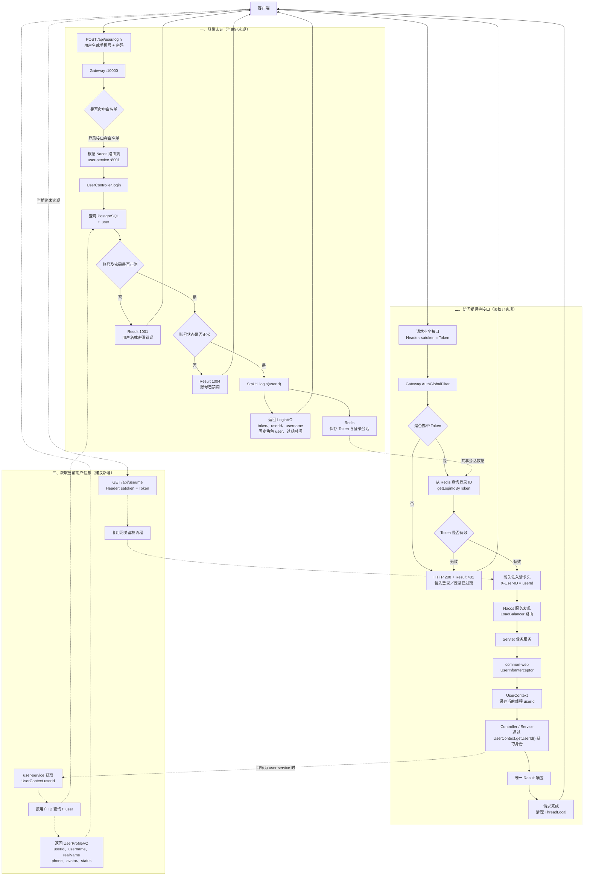

# User Service 用户服务

`user-service` 负责用户账号注册、登录、密码校验、账号状态检查和 Sa-Token 会话创建，是当前后端的用户身份数据源。

## 服务信息

| 项目 | 当前值 |
| --- | --- |
| Maven 模块 | `xyz.jiayuhan:user-service` |
| 应用名 | `user-service` |
| 默认端口 | `8001` |
| Web 技术栈 | Spring MVC |
| 数据库 | PostgreSQL，数据库名当前为 `user_db` |
| ORM | MyBatis-Plus |
| 会话 | Sa-Token + Redis |
| 服务注册 | Nacos |
| 启动类 | `xyz.jiayuhan.userservice.UserServiceApplication` |

## 已实现功能

- 使用用户名或手机号登录；
- 使用 BCrypt 校验和存储密码；
- 校验用户名、手机号唯一性；
- 校验账号是否被禁用；
- 登录成功后创建 Sa-Token 会话并写入 Redis；
- 通过 `common-web` 统一处理参数校验和业务异常。

RabbitMQ 与 OpenFeign 依赖已经预留，但当前源码尚未发布消息，也没有定义 Feign 客户端。

## 登录认证与用户信息流程

下图同时展示当前已经实现的登录、网关鉴权和用户身份透传链路，以及建议补充的“获取当前用户信息”链路。虚线部分表示尚未实现的能力。



该方案遵循以下边界：网关只负责校验会话并透传可信用户 ID；业务服务通过 `UserContext` 获取身份；完整用户资料由 `user-service` 按需查询，不能在服务之间传递密码字段。

## API

经网关访问时，基础地址为：

```text
http://localhost:10000/api/user
```

### 用户注册

```http
POST /api/user/register
Content-Type: application/json
```

请求体：

```json
{
  "username": "demo_user",
  "password": "123456",
  "realName": "示例用户",
  "phone": "13800138000"
}
```

校验规则：

| 字段 | 必填 | 规则 |
| --- | --- | --- |
| `username` | 是 | 3～20 位，仅字母、数字、下划线 |
| `password` | 是 | 6～20 位 |
| `realName` | 否 | 最多 50 个字符 |
| `phone` | 是 | `1` 开头的 11 位数字 |

成功响应：

```json
{
  "code": 200,
  "message": "注册成功",
  "data": {
    "id": 123456789012345678,
    "username": "demo_user"
  }
}
```

可能的业务错误：

| 业务码 | 含义 |
| ---: | --- |
| `400` | 请求参数校验失败 |
| `1002` | 用户名已存在 |
| `1003` | 手机号已被注册 |

### 用户登录

```http
POST /api/user/login
Content-Type: application/json
```

请求体中的 `username` 可以是用户名或手机号：

```json
{
  "username": "demo_user",
  "password": "123456"
}
```

成功响应：

```json
{
  "code": 200,
  "message": "登录成功",
  "data": {
    "token": "生成的令牌",
    "tokenName": "satoken",
    "userId": 123456789012345678,
    "username": "demo_user",
    "role": "user",
    "expireAt": "2026-08-25T12:00:00"
  }
}
```

后续受保护请求需携带：

```http
satoken: <登录响应中的 token>
```

可能的业务错误：

| 业务码 | 含义 |
| ---: | --- |
| `400` | 用户名或密码为空 |
| `1001` | 用户名或密码错误 |
| `1004` | 账号已禁用 |

## 数据模型

实体 `User` 映射 PostgreSQL 表 `t_user`：

| 列 | Java 类型 | 说明 |
| --- | --- | --- |
| `id` | `Long` | 主键，由 MyBatis-Plus 雪花算法生成 |
| `username` | `String` | 登录用户名，应有唯一约束 |
| `password` | `String` | BCrypt 哈希，不存储明文 |
| `real_name` | `String` | 真实姓名 |
| `phone` | `String` | 手机号，应有唯一约束 |
| `avatar` | `String` | 头像地址，注册时默认为空字符串 |
| `status` | `Integer` | `1` 正常，`0` 禁用 |
| `created_at` | `LocalDateTime` | 注册时间 |
| `updated_at` | `LocalDateTime` | 最后更新时间 |

仓库当前没有数据库迁移脚本。部署者需要提前创建 `t_user`，并为用户名和手机号添加数据库唯一约束；时间字段应由数据库默认值、触发器或后续的 MyBatis-Plus 自动填充策略负责写入。

## 运行依赖

- JDK 21；
- PostgreSQL 及 `t_user` 表；
- Redis，用于 Sa-Token 会话持久化；
- Nacos，用于服务注册；
- `common-core`、`common-web`、`common-redis` 公共模块。

## 启动

在 `back` 目录执行：

```powershell
.\mvnw.cmd install -DskipTests
.\mvnw.cmd -pl user-service spring-boot:run
```

也可以直接运行 `UserServiceApplication`。启动后可检查：

```text
GET http://localhost:8001/actuator/health
```

正常情况下，服务还会以 `user-service` 名称注册到 Nacos。

## 关键配置

| 配置前缀 | 作用 |
| --- | --- |
| `server.port` | 服务监听端口 |
| `spring.cloud.nacos.discovery` | Nacos 注册与发现 |
| `spring.datasource` | PostgreSQL 连接 |
| `spring.data.redis` | Redis 连接 |
| `mybatis-plus` | 下划线映射和 SQL 日志 |
| `sa-token` | Token 名称、有效期、活跃超时和并发策略 |

当前配置文件包含固定的远程基础设施地址和凭据。部署前应迁移到环境变量或 Nacos 配置中心，并轮换已经进入配置文件的凭据。生产环境还应关闭 MyBatis-Plus 标准输出 SQL 日志，避免泄露敏感数据。

## 业务与安全约定

- 登录失败统一返回“用户名或密码错误”，避免泄露账号是否存在。
- 密码仅使用 BCrypt 哈希落库，日志和响应中不得输出密码。
- 网关注入的 `X-User-ID` 由 `common-web` 提取；服务不应直接暴露到公网。
- 当前角色固定返回 `user`，尚未接入持久化角色或权限模型。
- 注册接口先查询再插入，数据库唯一约束仍是并发注册场景下的最终一致性保障。
