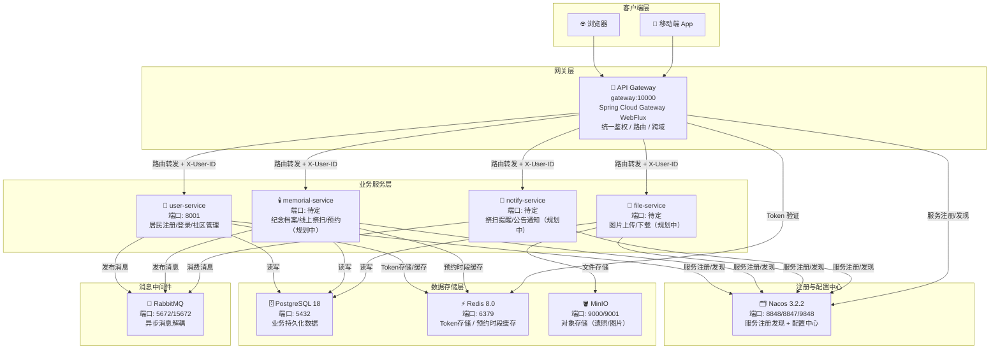
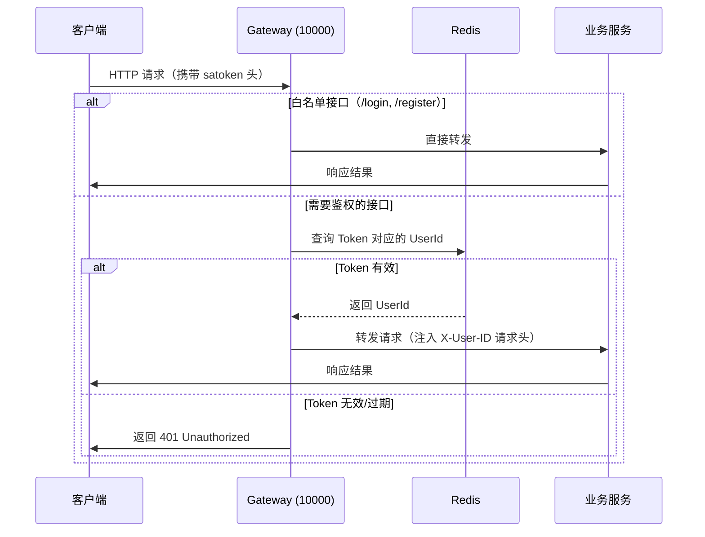

# 系统架构图说明

> **文档版本**：v2.0.0 | **最后更新**：2026-08-06 | **状态**：已完成

---

## 1. 整体微服务架构图



---

## 2. 请求处理流程图



---

## 3. 各层职责说明

### 3.1 客户端层

| 客户端类型 | 说明 |
|------------|------|
| 浏览器 | 管理后台（Vue3），社区管理员审核档案/管理预约/发布公告 |
| 移动端 App | 居民端（UniApp），注册登录/纪念档案/线上祭扫/预约祭扫 |

所有客户端统一通过 **API Gateway（端口 10000）** 作为唯一入口，不直接访问后端业务服务。

### 3.2 网关层（Gateway）

**职责**：
- **统一入口**：所有外部请求必须经过网关，内部服务之间通过 Feign 直接调用
- **身份鉴权**：解析请求头中的 `satoken`，通过 Redis 验证 Token 有效性，提取 `userId` 注入 `X-User-ID` 请求头
- **路由转发**：根据路由规则将请求转发到对应的后端服务（通过 Nacos 服务发现）
- **跨域处理**：统一配置跨域（CORS）策略，下游服务无需单独处理
- **全局过滤**：请求日志记录、限流（可扩展）等全局处理

**技术实现**：`spring-cloud-starter-gateway-server-webflux`（WebFlux 响应式）

### 3.3 业务服务层

| 服务 | 端口 | 主要职责 |
|------|------|----------|
| `user-service` | 8001 | 居民注册登录、社区绑定、居民信息管理 |
| `memorial-service` | 待定 | 逝者纪念档案、线上祭扫（献花/点烛/留言）、祭扫预约 |
| `file-service` | 待定 | 图片上传至 MinIO、生成访问 URL、文件管理 |
| `notify-service` | 待定 | 消费 RabbitMQ 消息，发送祭扫提醒/审核通知/社区公告 |

**服务间通信方式**：
- **同步调用**：OpenFeign（基于 HTTP，走 Nacos 服务发现 + 负载均衡）
- **异步通信**：RabbitMQ（业务事件发布，通知服务订阅消费）

### 3.4 注册与配置中心（Nacos）

| 功能 | 说明 |
|------|------|
| 服务注册 | 各微服务启动时向 Nacos 注册实例，心跳保活 |
| 服务发现 | 网关和 Feign 通过 Nacos 查询目标服务的实例列表 |
| 配置管理 | 各服务配置集中存储于 Nacos，DataID 格式：`${spring.application.name}.yaml` |
| 配置热更新 | 配置变更后，Nacos 自动推送至各服务，无需重启 |

### 3.5 数据存储层

| 组件 | 端口 | 用途 |
|------|------|------|
| PostgreSQL 18 | 5432 | 居民/社区、纪念档案、预约、公告等业务数据持久化 |
| Redis 8.0 | 6379 | Sa-Token Token 存储、预约时段名额缓存、分布式锁 |
| MinIO | 9000(API)/9001(Web) | 遗照、祭扫图片、居民头像等文件存储 |

### 3.6 消息中间件（RabbitMQ）

| 场景 | 生产者 | 消费者 | 说明 |
|------|--------|--------|------|
| 居民注册欢迎 | `user-service` | `notify-service` | 居民注册成功后发送欢迎站内信 |
| 档案审核结果 | `memorial-service` | `notify-service` | 纪念档案审核通过/驳回后通知创建者 |
| 祭扫预约提醒 | `memorial-service` | `notify-service` | 预约确认、临近祭扫日期提醒 |

---

## 4. 网络拓扑说明

```
互联网
   │
   ▼
服务器公网 IP：122.51.234.113
   │
   ▼
防火墙（开放端口：10000/...）
   │
   ▼
Docker 网络（bridge 模式）
   ├── gateway:10000
   ├── user-service:8001
   ├── postgres:5432
   ├── redis:6379
   ├── nacos:8848/8847/9848
   ├── rabbitmq:5672/15672
   └── minio:9000/9001
```

> **安全建议**：生产环境中，中间件端口（PostgreSQL/Redis/RabbitMQ 等）不应直接对外暴露，应仅允许 Docker 内部网络访问。仅网关端口（10000）和必要的管理端口对外开放。

---

## 5. 部署架构说明

当前采用**单服务器部署**方案：

```
┌─────────────────────────────────────────────┐
│              122.51.234.113 (4核4G)         │
│                                             │
│  ┌──────────────────────────────────────┐  │
│  │           Docker Compose             │  │
│  │  ┌──────────┐ ┌──────┐ ┌─────────┐  │  │
│  │  │PostgreSQL│ │Redis │ │  Nacos  │  │  │
│  │  └──────────┘ └──────┘ └─────────┘  │  │
│  │  ┌──────────┐ ┌─────────────────┐   │  │
│  │  │ RabbitMQ │ │      MinIO      │   │  │
│  │  └──────────┘ └─────────────────┘   │  │
│  └──────────────────────────────────────┘  │
│                                             │
│  ┌──────────────────────────────────────┐  │
│  │           Java 微服务进程             │  │
│  │  ┌─────────┐  ┌──────────────────┐  │  │
│  │  │ gateway │  │  user-service    │  │  │
│  │  │  :10000 │  │     :8001        │  │  │
│  │  └─────────┘  └──────────────────┘  │  │
│  └──────────────────────────────────────┘  │
└─────────────────────────────────────────────┘
```

> 📝 待补充：若后续服务数量增多，可考虑迁移至 Kubernetes 集群部署。
