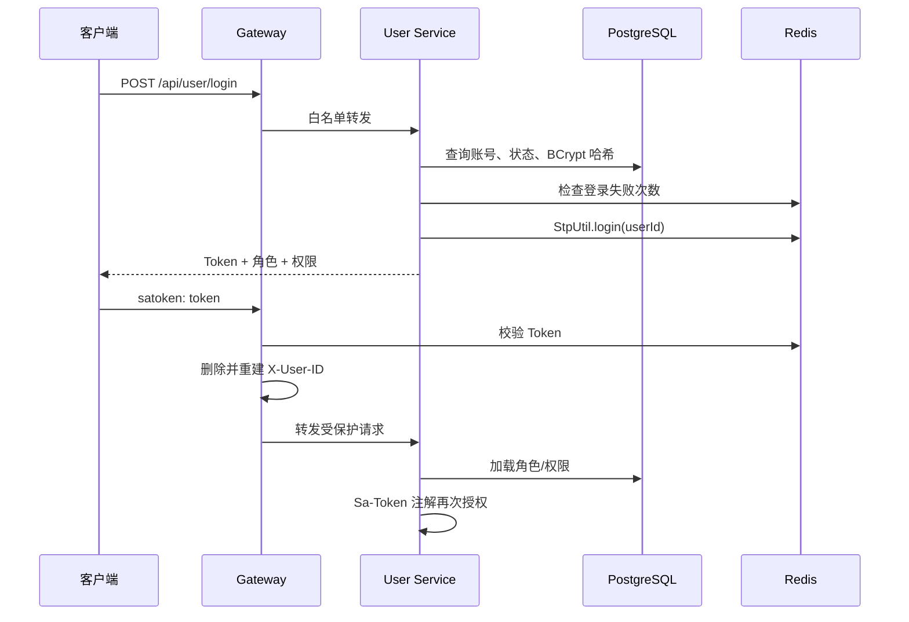
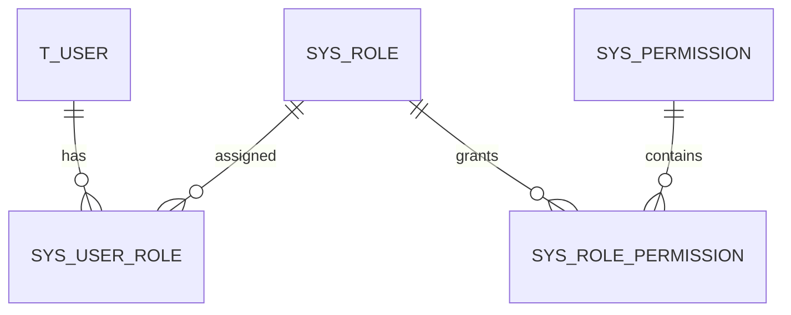

# 安全鉴权设计

## 1. 总体模型

系统采用 Sa-Token 有状态会话，不重复实现 JWT Refresh Token。Redis 保存 Token、登录 ID 与会话状态，因此服务可以即时退出、禁用账号和踢人下线。

## 2. 分层职责

| 层级 | 职责 |
|---|---|
| 客户端 | 安全保存 Token、按 `tokenName` 携带、会话失效后清理 |
| Gateway | 默认拒绝匿名请求、过滤伪造身份头、校验 Redis 会话 |
| User Service | 再次校验登录、角色和权限；检查账号状态与业务约束 |
| PostgreSQL | 用户、角色、权限及关联关系的权威数据源 |
| Redis | Sa-Token 会话、登录失败短期计数 |

网关认证不是服务内授权的替代品。`user-service:8001` 即使被直连，`@SaCheckLogin` 和 `@SaCheckPermission` 仍会生效。

## 3. RBAC

- 用户与角色、角色与权限均为多对多；
- Sa-Token `StpInterface` 每次从 RBAC 表加载有效角色和权限码；
- 管理接口使用细粒度权限码，不只判断“是不是管理员”；
- 注册账号默认分配 `user`；
- `admin` 拥有当前全部系统权限，两个内置角色受保护；
- 新业务权限由新迁移脚本写入 `sys_permission`，再授权给角色。

## 4. 密码与登录保护

- 密码只保存 BCrypt 哈希，默认 cost 为 12，可通过 `BCRYPT_STRENGTH` 覆盖；
- BCrypt 输入上限按 72 字符校验；
- 不存在账号和密码错误统一返回 `1001`，防止账号枚举；
- 登录失败计数的 Redis Key 使用账号 SHA-256，不泄露手机号或邮箱；
- 默认 15 分钟内失败 5 次后暂时拒绝登录；
- 登录成功清空失败计数，并更新最近登录时间和 IP；
- 生产环境必须通过 HTTPS 传输明文登录密码和 Token。

## 5. 会话失效策略

| 操作 | 会话处理 |
|---|---|
| 当前用户退出 | 注销当前 Token |
| 当前用户改密 | 踢下该账号全部会话 |
| 管理员禁用/删除用户 | 踢下目标账号全部会话 |
| 管理员重置密码 | 踢下目标账号全部会话 |
| 管理员调整用户角色 | 踢下目标账号全部会话 |

会话最长有效期和无操作有效期分别由 `SA_TOKEN_TIMEOUT`、`SA_TOKEN_ACTIVE_TIMEOUT` 控制。Gateway 与 User Service 必须使用相同 Token 名称、Redis 实例和数据库编号。

## 6. 管理安全

- 管理员不能通过管理接口禁用、删除、重置自己或修改自己的角色；
- 禁止禁用、删除或重分配 `admin`、`user` 内置角色；
- 正在被用户引用的自定义角色不能删除；
- 用户删除采用逻辑删除，同时清理用户角色关系；
- 数据库唯一索引是并发写入的最终防线，应用层校验只负责友好提示。

## 7. 配置与密钥

- 仓库仅保留本地开发默认值；
- 生产密码和地址通过环境变量或 Nacos 注入；
- 初始管理员密码只通过 `BOOTSTRAP_ADMIN_PASSWORD` 临时传入；
- 初始化完成后关闭 `BOOTSTRAP_ADMIN_ENABLED`；
- 日志不得输出密码、Token、Redis 密码或数据库密码。

## 8. 尚需按选题接入的能力

自助忘记密码需要真实的短信/邮件供应商，当前不提供可绕过验证的重置接口。接入时至少需要：一次性验证码哈希、短有效期、发送与验证次数限制、使用后失效、风险审计和会话全部注销。
