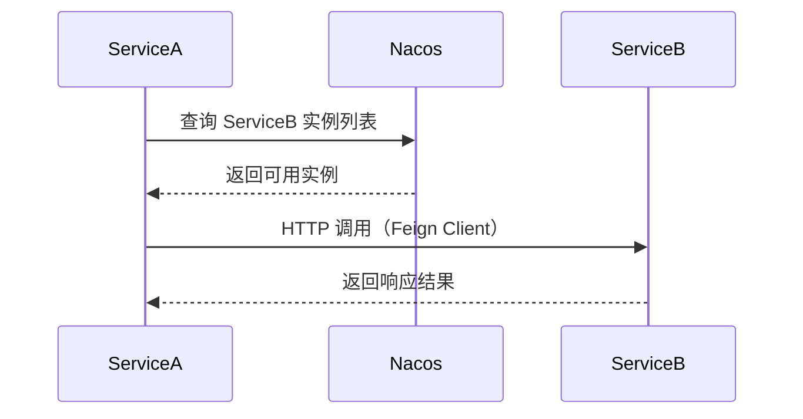
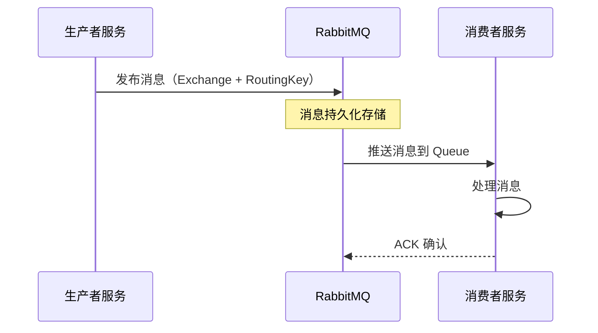
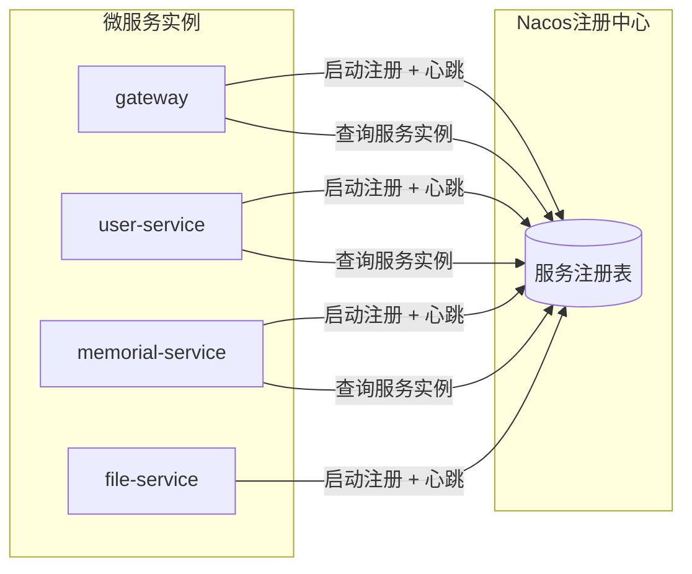
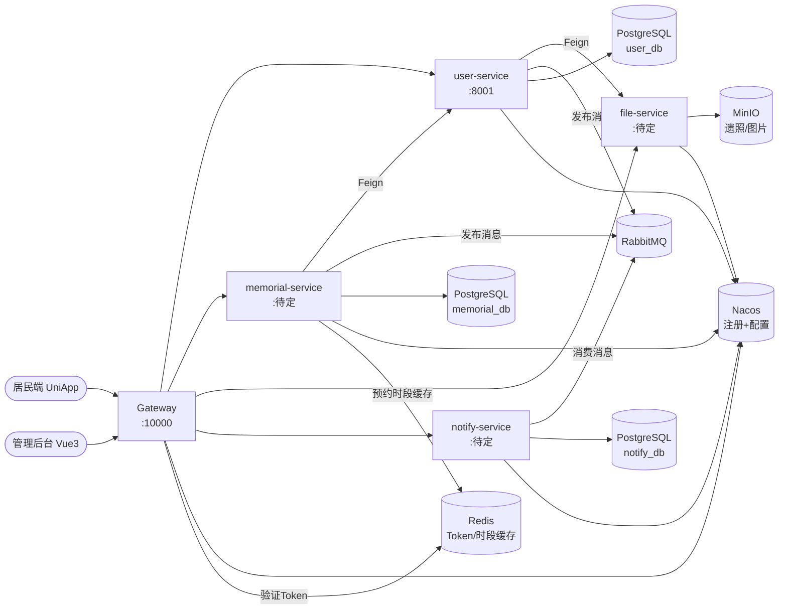
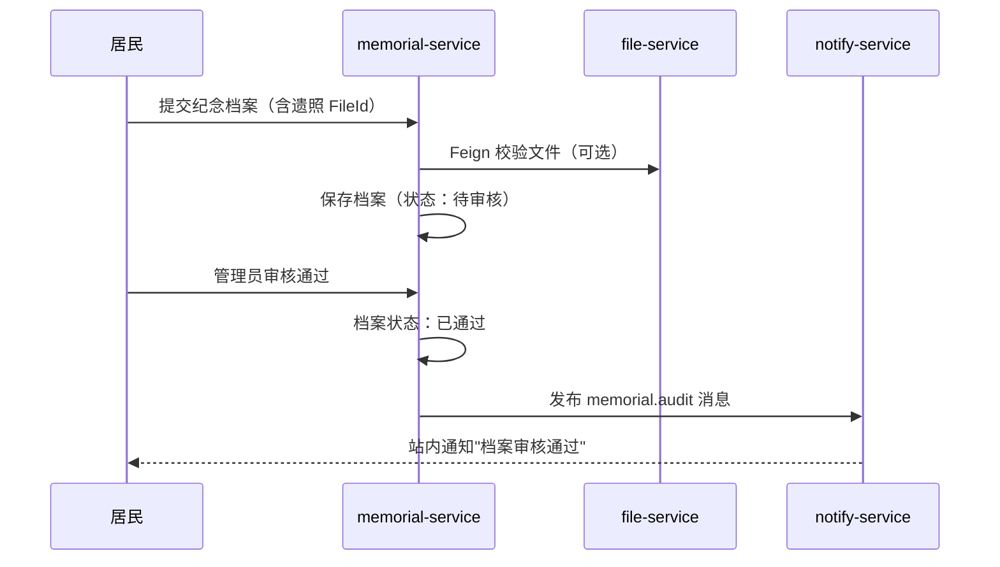
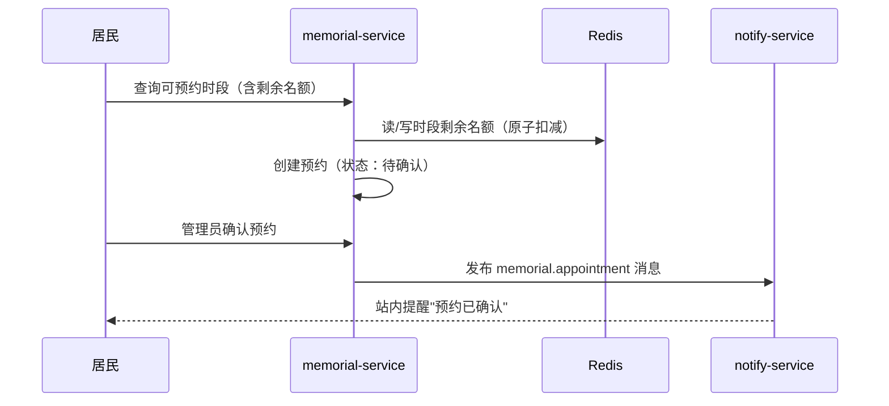

# 微服务架构设计

> **文档版本**：v2.0.0 | **最后更新**：2026-08-06 | **状态**：已完成

---

## 1. 微服务拆分原则

本项目遵循以下微服务拆分原则：

### 1.1 单一职责原则（SRP）

每个微服务只负责一个清晰的业务域，服务边界与业务边界一致：

- `user-service`：居民账号与社区管理
- `memorial-service`：纪念档案、线上祭扫与祭扫预约（核心业务）
- `file-service`：图片/文件存储与访问管理
- `notify-service`：祭扫提醒、公告与消息通知

### 1.2 高内聚低耦合

- **高内聚**：同一业务功能的代码集中在同一服务内，减少跨服务调用
- **低耦合**：服务间通过定义良好的 API 接口通信，不共享数据库

### 1.3 数据库独立原则

每个微服务**独占**自己的数据库 Schema，禁止跨服务直接查询其他服务的数据库表。跨服务数据访问必须通过 API 调用或消息队列。

| 服务 | 数据库 Schema |
|------|--------------|
| user-service | user_db |
| memorial-service | memorial_db |
| file-service | file_db |
| notify-service | notify_db |

### 1.4 服务粒度权衡

本项目规模属于中小型毕业设计，服务粒度**不宜过细**，避免引入过多的网络调用和运维复杂度。每个服务覆盖一个完整业务子域，而非拆分至单个功能。纪念祭扫作为系统的**核心业务**独立成服务，便于聚焦开发与论文论述。

---

## 2. 各服务边界定义

### 2.1 gateway（网关服务）

**职责边界**：
- ✅ 请求路由与负载均衡
- ✅ 统一鉴权（Token 验证）
- ✅ 用户身份注入（X-User-ID 请求头）
- ✅ 跨域（CORS）统一处理
- ✅ 请求日志（全局 Filter）
- ❌ **不包含**任何业务逻辑
- ❌ **不直接访问**业务数据库

**技术特点**：基于 Spring Cloud Gateway WebFlux，响应式非阻塞编程。

### 2.2 user-service（用户与社区服务）

**职责边界**：
- ✅ 居民注册、登录（颁发 Token）、退出
- ✅ 居民基本信息 CRUD
- ✅ 密码加密存储与验证
- ✅ 社区信息维护、居民加入社区
- ✅ 注册成功事件发布（RabbitMQ）
- ❌ **不处理**文件存储（头像 URL 仅存储，上传由 file-service 处理）
- ❌ **不发送**通知（通过消息队列委托 notify-service）

**技术特点**：Spring Web + MyBatis-Plus + Redis + RabbitMQ + Nacos

### 2.3 memorial-service（纪念祭扫服务，规划中）

**职责边界**：
- ✅ 逝者纪念档案的创建、审核、展示
- ✅ 线上祭扫（献花、点烛、上香、追思留言）
- ✅ 祭扫错峰预约（时段管理、名额控制）
- ✅ 祭扫记录与统计数据查询
- ❌ **不处理**图片存储（遗照上传由 file-service 处理）
- ❌ **不发送**提醒（审核结果、预约提醒通过消息队列委托 notify-service）

**技术特点**：Spring Web + MyBatis-Plus + Redis + RabbitMQ + Nacos

### 2.4 file-service（文件服务，规划中）

**职责边界**：
- ✅ 图片上传至 MinIO（遗照、祭扫图片、头像）
- ✅ 生成文件访问 URL
- ✅ 文件元数据管理（file_db）
- ✅ 文件删除

### 2.5 notify-service（通知服务，规划中）

**职责边界**：
- ✅ 消费 RabbitMQ 消息队列（审核通知、预约提醒、注册欢迎）
- ✅ 社区公告发布与查询
- ✅ 站内消息存储与已读管理

---

## 3. 服务间通信方式

### 3.1 同步调用（OpenFeign）

用于**需要立即获取结果**的场景，如查询另一服务的数据。



**使用场景示例**：
- 纪念祭扫服务调用用户服务查询居民/社区信息
- 用户服务调用文件服务查询居民头像 URL

**注意事项**：
- Feign 调用时通过拦截器自动传递 `X-User-ID` 请求头，确保下游服务能获取用户身份
- 配置合理的超时时间和重试策略，避免雪崩

### 3.2 异步通信（RabbitMQ）

用于**不需要立即获取结果**的场景，解耦服务依赖。



**当前规划的 Exchange 和 Queue**：

| Exchange | Exchange 类型 | Queue | RoutingKey | 说明 |
|----------|--------------|-------|------------|------|
| user.exchange | direct | user.register.queue | user.register | 居民注册成功事件（欢迎通知） |
| memorial.exchange | direct | memorial.audit.queue | memorial.audit | 档案审核结果事件 |
| memorial.exchange | direct | memorial.appointment.queue | memorial.appointment | 预约确认/临近提醒事件 |

---

## 4. 配置中心设计（Nacos）

### 4.1 配置分层策略

```
Nacos 配置中心
├── 共享配置（shared-config.yaml）   ← 各服务共用的通用配置
│   ├── 日志级别配置
│   └── 公共常量配置
├── gateway.yaml                     ← 网关专属配置
│   ├── 路由规则
│   ├── 鉴权白名单
│   └── 跨域配置
├── user-service.yaml                ← 用户与社区服务专属配置
│   ├── PostgreSQL 连接配置
│   ├── Redis 连接配置
│   ├── RabbitMQ 连接配置
│   └── Sa-Token 配置
├── memorial-service.yaml            ← 纪念祭扫服务专属配置（规划中）
│   ├── PostgreSQL 连接配置（memorial_db）
│   ├── Redis 连接配置（预约时段缓存）
│   └── RabbitMQ 连接配置
└── file-service.yaml / notify-service.yaml  ← 待开发
```

### 4.2 DataID 命名规范

```
格式：${spring.application.name}.yaml
示例：
  - gateway.yaml
  - user-service.yaml
  - memorial-service.yaml
```

### 4.3 Group 规范

| Group | 用途 |
|-------|------|
| DEFAULT_GROUP | 默认组，各服务配置文件 |

---

## 5. 服务发现机制



**服务发现流程**：
1. 服务启动时向 Nacos 注册实例（IP + 端口）
2. 每 5 秒发送心跳包，超时（默认 15s）则被标记为不健康
3. 调用方通过 Nacos 获取实例列表，结合 Spring Cloud LoadBalancer 实现负载均衡
4. 实例下线时从注册表删除，路由表自动更新

---

## 6. 完整服务调用关系图



---

## 7. 核心业务时序（纪念祭扫主流程）

### 7.1 创建纪念档案 → 审核 → 展示



### 7.2 错峰预约 → 确认 → 提醒



---

## 8. 关键设计决策

| 决策点 | 选择 | 理由 |
|--------|------|------|
| 网关编程模型 | WebFlux 响应式 | 高性能 I/O，适合请求转发场景 |
| Token 存储位置 | Redis（集中式） | 支持分布式验证，支持主动失效 |
| 用户身份传递 | X-User-ID 请求头 | 简单、解耦，下游服务无需关心 Token 格式 |
| 服务注册 | Nacos | 同时承担配置中心，减少中间件数量 |
| 异步通信 | RabbitMQ | 适合任务队列（审核通知、预约提醒），运维简单 |
| 纪念业务独立成服务 | memorial-service | 核心业务聚焦，边界清晰，便于论文论述 |
| 预约名额控制 | Redis 原子扣减 | 防止并发超卖，保证同一时段预约人数不超限 |
