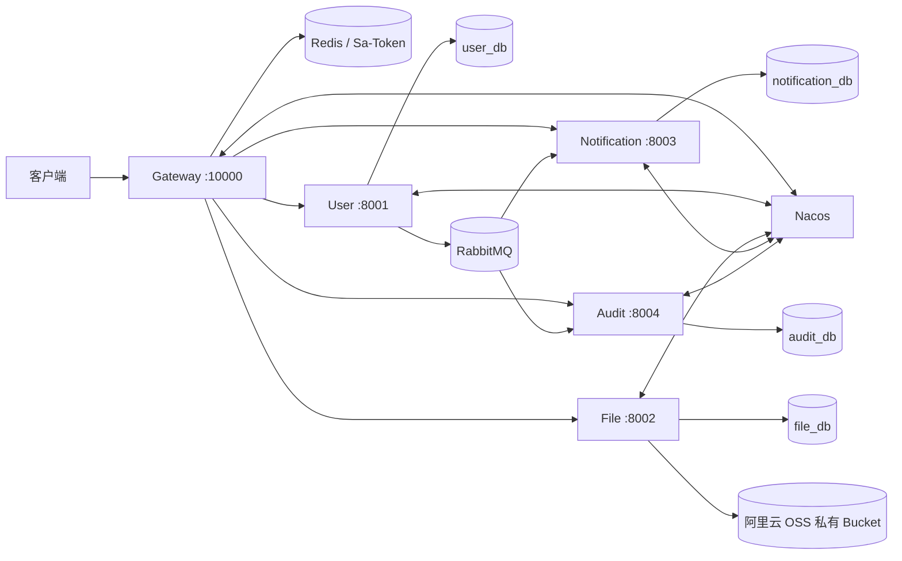

# 微服务基础架构设计

## 1. 服务边界

| 模块 | 核心职责 | 不负责 |
| --- | --- | --- |
| Gateway | 入口路由、Token 校验、身份头、TraceId | 领域业务规则 |
| User Service | 认证、账户、用户管理、RBAC、事件发件箱 | 业务资料、文件内容、通知和审计存储 |
| File Service | 文件所有权、元数据、阿里云 OSS 私有对象 | 公开文件 CDN 和业务附件关系 |
| Notification Service | 站内通知、未读状态、注册事件消费 | 邮件/短信供应商发送 |
| Audit Service | 异步操作审计与个人查询 | 业务事务同步阻塞写审计库 |
| Common | 稳定的技术性公共能力 | 具体服务实体和领域规则 |

## 2. 调用关系

同步 HTTP 用于当前请求必须立即得到结果的查询或命令；欢迎通知、审计等跨服务副作用使用事件，避免业务服务互相持有数据库连接或形成同步调用链。

## 3. 数据所有权

- 每个服务独占数据库，Flyway 迁移也随服务发布。
- 禁止跨库直连或跨服务 Mapper；需要的数据通过 API 或事件契约交换。
- 事件中只传递稳定标识和必要快照，不传密码、Token、AccessKey 等秘密。
- 文件二进制在阿里云 OSS，业务服务只保存文件 ID；文件访问由 File Service 统一做所有权校验。

## 4. 公共层原则

公共模块按能力拆分为 core、web、security、data、redis、openapi、observability 和 mq。服务只引用实际需要的模块。WebFlux Gateway 不引入 Servlet 公共模块，避免两套 Web 栈冲突。

## 5. 扩展新业务

1. 按领域边界确定服务、数据库、API 前缀和权限码。
2. 外部路径统一加入 Gateway，受保护接口默认不进白名单。
3. 跨服务异步副作用复用领域事件规范，并由消费者拥有自己的队列。
4. 新表使用 Flyway 增量迁移，已发布迁移不可修改。
5. 同步补充接口、数据库、消息、部署和测试文档。
