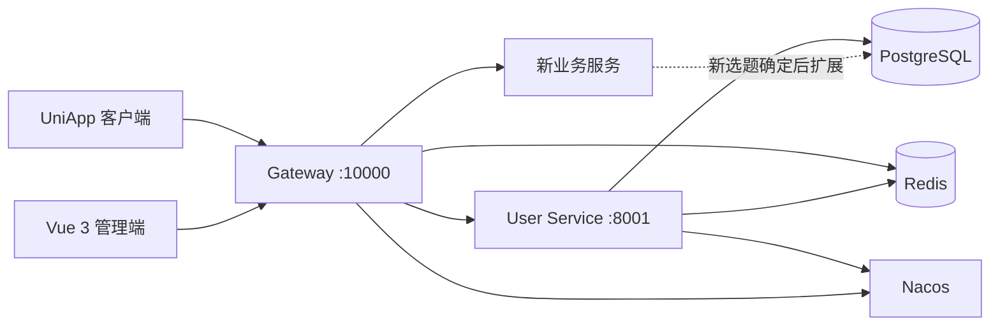

# 微服务基础架构设计

## 1. 当前范围

仓库当前只保留与具体选题无关的基础模块：

- `gateway`：统一 API 入口、服务路由、Token 校验、跨域和接口文档聚合。
- `user-service`：认证会话、个人账户、用户管理、RBAC 和用户数据访问。
- `common-core`：统一响应、业务异常和通用错误码。
- `common-web`：Web 配置、全局异常处理和用户上下文。
- `common-redis`：Redis 与 Sa-Token 的共享配置。
- `management`：Vue 3 管理端骨架。
- `client-app`：UniApp 客户端骨架。

## 2. 基础调用关系

## 3. 基础设施职责

| 组件 | 职责 |
|---|---|
| Nacos | 服务注册发现和配置管理 |
| Redis | 登录会话、缓存和短期状态 |
| PostgreSQL | 结构化业务数据持久化 |
| RabbitMQ | 后续业务的异步事件与削峰解耦 |
| MinIO | 后续业务的图片、附件等对象存储 |

## 4. 新业务扩展原则

1. 新业务应按领域边界新增服务，不把所有逻辑堆入 `user-service`。
2. 每个服务独立维护自己的数据表和配置，跨服务通过接口或事件通信。
3. 外部请求统一经过网关；服务内仍需校验权限和数据归属。
4. 公共模块只放稳定、可复用的能力，不放具体业务实体或业务规则。
5. 新选题未确定前，不预建业务表、业务错误码和领域接口。
6. 新业务权限码可以加入用户服务的权限字典，但领域数据和业务流程仍归新服务。

## 5. 分支约定

后续开发统一在 `dev` 分支进行。功能较大时可从 `dev` 创建功能分支，完成验证后再合并回 `dev`。
