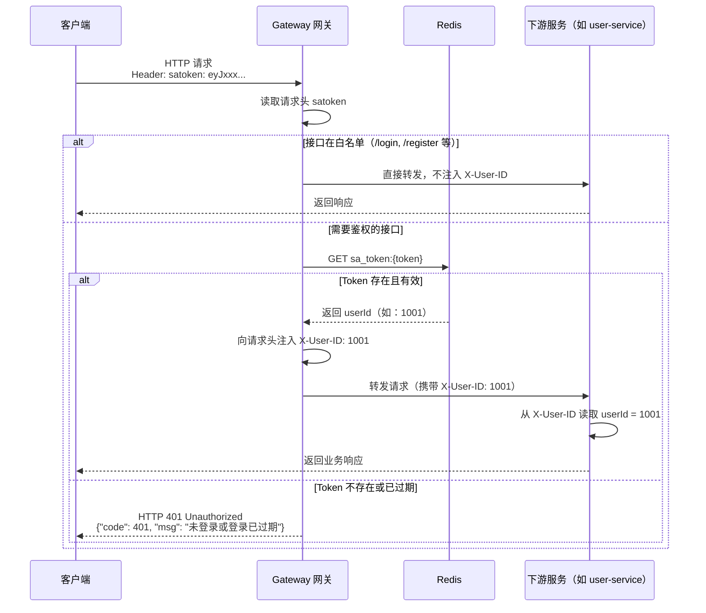
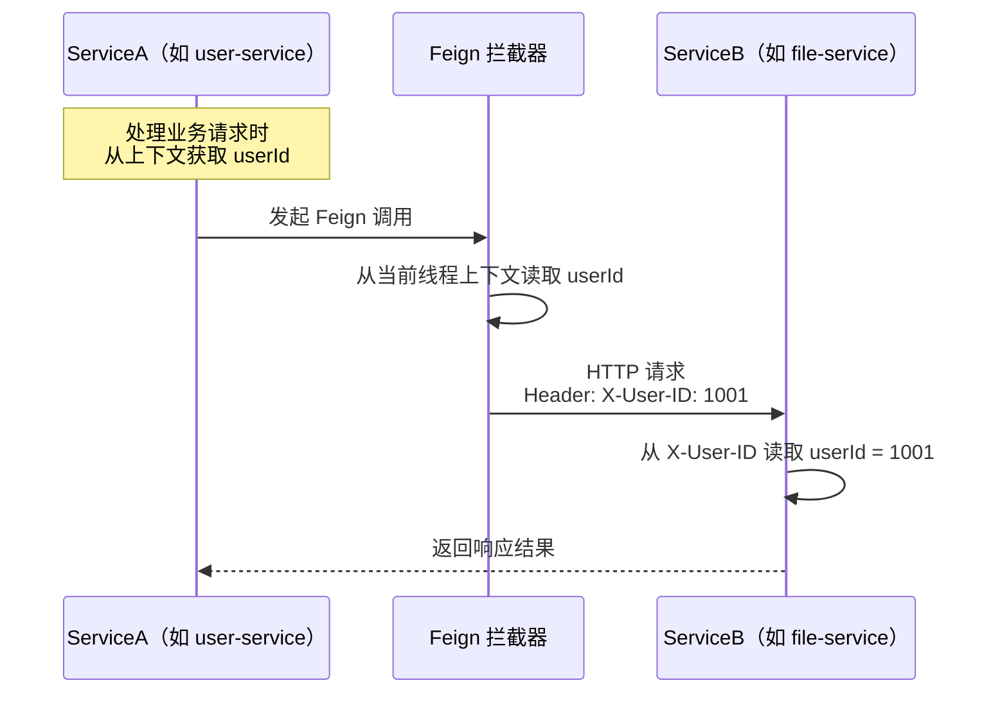

# 用户信息传递方案

> **文档版本**：v1.0.0 | **最后更新**：2026-06-07 | **状态**：已完成

---

## 1. 概述

在微服务架构中，用户身份信息的跨服务传递是一个核心设计问题。本项目采用**网关集中鉴权 + 请求头传递用户身份**的方案：

- **网关（Gateway）**：负责统一的 Token 鉴权，验证通过后将 `userId` 注入 `X-User-ID` 请求头
- **下游服务**：只从 `X-User-ID` 请求头读取用户身份，**不再验证 Token**，简化下游服务逻辑
- **Feign 调用**：服务间调用通过 Feign 拦截器自动传递 `X-User-ID`，确保调用链中用户身份不丢失

这种设计实现了**鉴权与业务逻辑的解耦**，降低了各微服务的开发复杂度。

---

## 2. 整体流程

### 2.1 外部请求流程（客户端 → 网关 → 下游服务）



### 2.2 服务间调用流程（Feign 调用）



---

## 3. 关键实现代码

### 3.1 网关鉴权全局过滤器

```java
// Gateway 中的全局鉴权过滤器
@Component
public class AuthGlobalFilter implements GlobalFilter, Ordered {

    private final RedisTemplate<String, String> redisTemplate;
    private final List<String> whitelist = List.of(
        "/api/user/login",
        "/api/user/register"
    );

    @Override
    public Mono<Void> filter(ServerWebExchange exchange, GatewayFilterChain chain) {
        String path = exchange.getRequest().getPath().value();
        
        // 白名单接口直接放行
        if (isWhitelisted(path)) {
            return chain.filter(exchange);
        }

        // 从请求头获取 Token
        String token = exchange.getRequest().getHeaders().getFirst("satoken");
        if (token == null || token.isBlank()) {
            return unauthorized(exchange);
        }

        // 从 Redis 获取 userId
        String userId = redisTemplate.opsForValue().get("sa_token:" + token);
        if (userId == null) {
            return unauthorized(exchange);
        }

        // 将 userId 注入请求头，转发给下游服务
        ServerWebExchange mutatedExchange = exchange.mutate()
            .request(req -> req.header("X-User-ID", userId))
            .build();

        return chain.filter(mutatedExchange);
    }

    @Override
    public int getOrder() {
        return -100; // 优先级最高
    }
    
    // ... 省略辅助方法
}
```

### 3.2 下游服务读取用户身份

```java
// 在下游服务的 Controller 中读取 X-User-ID
@GetMapping("/info")
public Result<UserVO> getUserInfo(@RequestHeader("X-User-ID") Long userId) {
    UserVO userVO = userService.getUserById(userId);
    return Result.success(userVO);
}
```

或封装为工具类：

```java
// 用户上下文工具类（通过 ThreadLocal 或 @RequestHeader 获取）
public class UserContext {
    private static final ThreadLocal<Long> USER_ID_HOLDER = new ThreadLocal<>();
    
    public static void setUserId(Long userId) {
        USER_ID_HOLDER.set(userId);
    }
    
    public static Long getUserId() {
        return USER_ID_HOLDER.get();
    }
    
    public static void clear() {
        USER_ID_HOLDER.remove();
    }
}

// 配合 HandlerInterceptor 使用
@Component
public class UserContextInterceptor implements HandlerInterceptor {
    
    @Override
    public boolean preHandle(HttpServletRequest request, 
                              HttpServletResponse response, 
                              Object handler) {
        String userId = request.getHeader("X-User-ID");
        if (userId != null) {
            UserContext.setUserId(Long.parseLong(userId));
        }
        return true;
    }
    
    @Override
    public void afterCompletion(HttpServletRequest request, 
                                 HttpServletResponse response, 
                                 Object handler, Exception ex) {
        UserContext.clear(); // 防止内存泄漏
    }
}
```

### 3.3 Feign 请求拦截器（传递 X-User-ID）

```java
// Feign 请求拦截器，在服务间调用时传递 X-User-ID
@Component
public class FeignUserIdInterceptor implements RequestInterceptor {
    
    @Override
    public void apply(RequestTemplate template) {
        Long userId = UserContext.getUserId();
        if (userId != null) {
            template.header("X-User-ID", String.valueOf(userId));
        }
    }
}
```

---

## 4. Token 在 Redis 中的存储结构

```
Redis Key:   sa_token:eyJhbGciOiJIUzI1NiIsInR5cCI6IkpXVCJ9...
Redis Value: 1001           ← userId（Long 类型转 String 存储）
TTL:         604800         ← 7 天（单位：秒）
```

> **说明**：上述 Redis Key 格式为示意，实际由 Sa-Token 框架管理，格式可能略有不同（如 `satoken:login:token:xxxx`）。具体 Key 格式以 Sa-Token 官方文档为准。

---

## 5. 方案优势分析

| 优势 | 说明 |
|------|------|
| **鉴权集中管理** | Token 验证逻辑只在网关实现，下游服务无需关心鉴权细节，减少重复代码 |
| **下游服务简洁** | 下游服务只需读取 `X-User-ID` 请求头，代码极为简单 |
| **安全性保证** | 下游服务部署在私有网络，外部无法绕过网关直接访问，`X-User-ID` 头不会被伪造 |
| **易于扩展** | 若 Token 格式变更（JWT 换 Sa-Token），只需修改网关层，下游服务无需任何改动 |
| **支持 Feign 调用链** | 通过 Feign 拦截器，内部服务间调用也能传递用户身份，保持完整的调用上下文 |

---

## 6. 安全性考量

| 风险点 | 缓解措施 |
|--------|----------|
| 外部伪造 X-User-ID 请求头 | 网关过滤器统一覆盖此请求头，外部传入的值会被覆盖；下游服务不对外暴露端口 |
| Token 泄露 | Token 有过期时间（7天），支持主动失效（退出登录时删除 Redis Key） |
| Redis 宕机导致无法鉴权 | > 📝 待补充：考虑引入本地缓存降级或 Redis 高可用方案 |

---

## 7. 接口白名单清单

以下接口**不需要 Token**，网关直接放行：

| 接口路径 | 说明 |
|----------|------|
| `POST /api/user/login` | 用户登录（此接口本身颁发 Token） |
| `POST /api/user/register` | 用户注册 |
| `GET /actuator/health` | 健康检查端点 |

> 📝 待补充：随着业务发展，白名单可能需要动态配置，可考虑将白名单存储在 Nacos 配置中心，实现热更新。
