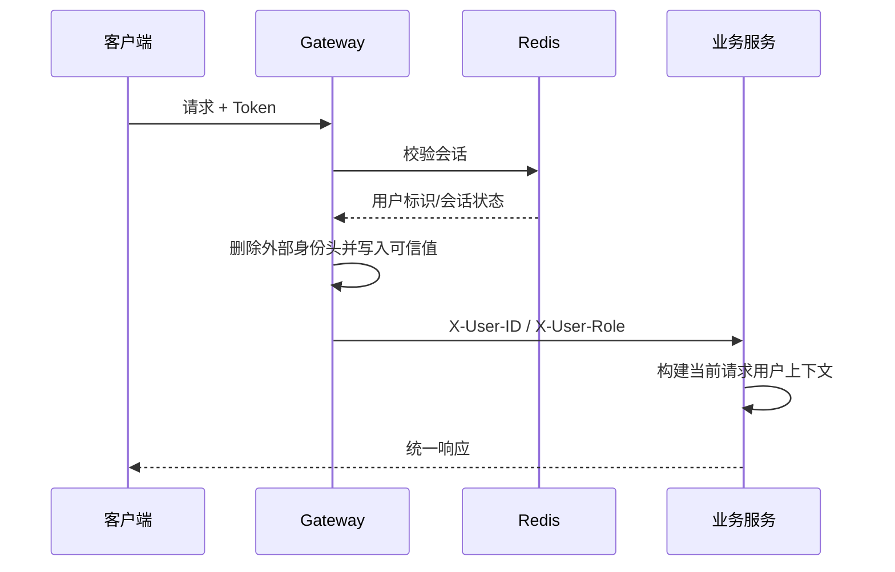

# 用户信息传递方案
新选题新增白名单时，应同步更新网关配置、接口文档和安全测试。
## 1. 目标

网关完成 Token 校验后，将可信的用户标识传递给下游服务，避免每个服务重复解析 Token，同时保证客户端不能伪造身份。

## 2. 传递流程

## 3. 请求头约定

| 请求头 | 用途 | 要求 |
|---|---|---|
| `X-User-ID` | 当前用户主键 | 由网关写入，下游只信任内网来源 |
| `X-User-Role` | 当前角色 | 基础框架可选，新业务按权限模型扩展 |

Gateway 必须先移除客户端原始的同名请求头。服务若允许绕过网关直连，应另行增加网络隔离或服务端 Token 校验，不能直接信任请求头。

## 4. 服务内使用

`common-web` 可在拦截器中读取请求头并写入线程级用户上下文，请求结束后必须清理，避免线程复用导致身份串用。异步任务和消息消费不能直接继承 HTTP 用户上下文，需要把必要身份作为消息字段显式传递。

## 5. 白名单

当前匿名接口仅包括：

- `POST /api/user/login`
- `POST /api/user/register`

新选题新增白名单时，应同步更新网关配置、接口文档和安全测试。
