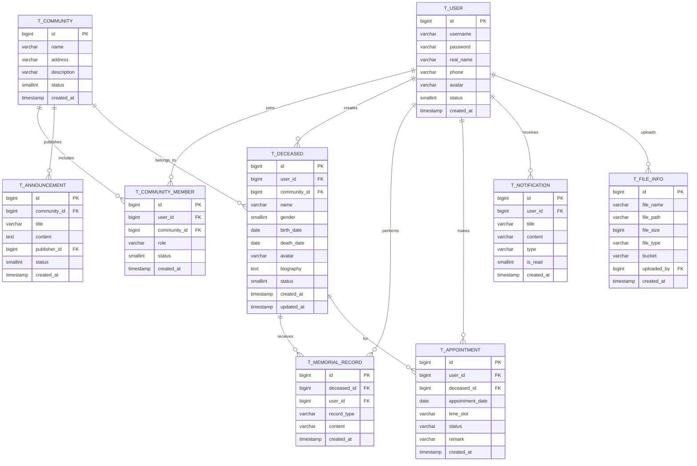

# 文明祭扫系统数据库设计 (Memorial System DB Design)

> **文档版本**：v2.0.0 | **最后更新**：2026-08-06 | **状态**：已完成

本文档定义《面向特定社区的文明祭扫系统》各微服务数据库 Schema 的表结构设计。遵循**每个服务独占一个 Schema** 的微服务数据库独立原则：

| 服务 | 数据库 | 包含表 |
|------|--------|--------|
| user-service | user_db | 居民、社区、社区成员 |
| memorial-service | memorial_db | 逝者纪念档案、线上祭扫记录、祭扫预约 |
| file-service | file_db | 文件元数据 |
| notify-service | notify_db | 站内通知、社区公告 |

---

## 一、实体关系图 (ER Diagram)



---

## 二、核心设计说明

1. **角色建模**：`t_community_member.role` 区分居民（resident）与社区管理员（community_admin），系统管理员（admin）由独立后台账号体系管理；`t_community_member` 承载"居民-社区"多对多关系。
2. **纪念档案状态机**：`t_deceased.status` 为 `0待审核 → 1已通过 → 2已驳回`，审核通过后公开展示，未通过的档案仅创建者可见。
3. **线上祭扫记录**：`t_memorial_record.record_type` 区分献花（flower）/点烛（candle）/上香（incense）/留言（message），留言内容存于 `content`，其余类型内容为空。
4. **错峰预约**：`t_appointment` 以「日期 + 时段」为单位记录预约，`status` 为 `0待确认 → 1已确认 → 2已取消 → 3已完成`；时段剩余名额在 Redis 中原子扣减控制（防止并发超卖）。
5. **通知解耦**：`t_notification`（站内信）与 `t_announcement`（社区公告）分离，公告按社区维度发布，通知按用户维度投递。

---

## 三、数据库建表 SQL (DDL)

### 3.1 user_db —— 用户与社区

```sql
-- ==========================================================
-- user_db：居民与社区体系
-- ==========================================================

-- 1. 居民表
CREATE TABLE t_user (
  id BIGINT PRIMARY KEY,
  username VARCHAR(50) NOT NULL,
  password VARCHAR(100) NOT NULL,
  real_name VARCHAR(50) DEFAULT '',
  phone VARCHAR(20) DEFAULT NULL,
  avatar VARCHAR(255) DEFAULT '',
  status SMALLINT DEFAULT 1,
  created_at TIMESTAMP DEFAULT CURRENT_TIMESTAMP,
  updated_at TIMESTAMP DEFAULT CURRENT_TIMESTAMP,
  CONSTRAINT uk_username UNIQUE (username),
  CONSTRAINT uk_phone UNIQUE (phone)
);
COMMENT ON TABLE t_user IS '居民用户表';
COMMENT ON COLUMN t_user.id IS '用户主键ID（MyBatis-Plus 雪花算法生成）';
COMMENT ON COLUMN t_user.username IS '登录用户名';
COMMENT ON COLUMN t_user.password IS '登录密码（BCrypt 加密）';
COMMENT ON COLUMN t_user.real_name IS '真实姓名';
COMMENT ON COLUMN t_user.phone IS '手机号（登录凭证之一）';
COMMENT ON COLUMN t_user.avatar IS '头像链接（file-service 上传后返回）';
COMMENT ON COLUMN t_user.status IS '账户状态：1正常，0禁用';

-- 2. 社区表
CREATE TABLE t_community (
  id BIGINT PRIMARY KEY,
  name VARCHAR(100) NOT NULL,
  address VARCHAR(200) DEFAULT '',
  description VARCHAR(500) DEFAULT '',
  status SMALLINT DEFAULT 1,
  created_at TIMESTAMP DEFAULT CURRENT_TIMESTAMP,
  CONSTRAINT uk_community_name UNIQUE (name)
);
COMMENT ON TABLE t_community IS '社区（小区/街道）表';
COMMENT ON COLUMN t_community.name IS '社区名称（如：XX小区）';
COMMENT ON COLUMN t_community.address IS '社区地址';
COMMENT ON COLUMN t_community.status IS '状态：1正常，0停用';

-- 3. 社区成员表（居民-社区多对多 + 角色）
CREATE TABLE t_community_member (
  id BIGINT PRIMARY KEY,
  user_id BIGINT NOT NULL,
  community_id BIGINT NOT NULL,
  role VARCHAR(30) DEFAULT 'resident',
  status SMALLINT DEFAULT 1,
  created_at TIMESTAMP DEFAULT CURRENT_TIMESTAMP,
  CONSTRAINT uk_user_community UNIQUE (user_id, community_id)
);
CREATE INDEX idx_cm_community ON t_community_member(community_id);
COMMENT ON TABLE t_community_member IS '社区成员关联表';
COMMENT ON COLUMN t_community_member.role IS '角色：resident居民，community_admin社区管理员';
COMMENT ON COLUMN t_community_member.status IS '成员状态：1有效，0已退出/被移除';
```

### 3.2 memorial_db —— 纪念祭扫核心业务

```sql
-- ==========================================================
-- memorial_db：纪念档案、线上祭扫、祭扫预约
-- ==========================================================

-- 4. 逝者纪念档案表
CREATE TABLE t_deceased (
  id BIGINT PRIMARY KEY,
  user_id BIGINT NOT NULL,
  community_id BIGINT NOT NULL,
  name VARCHAR(50) NOT NULL,
  gender SMALLINT DEFAULT 0,
  birth_date DATE,
  death_date DATE,
  avatar VARCHAR(255) DEFAULT '',
  biography TEXT,
  status SMALLINT DEFAULT 0,
  created_at TIMESTAMP DEFAULT CURRENT_TIMESTAMP,
  updated_at TIMESTAMP DEFAULT CURRENT_TIMESTAMP
);
CREATE INDEX idx_deceased_community ON t_deceased(community_id, status);
CREATE INDEX idx_deceased_user ON t_deceased(user_id);
COMMENT ON TABLE t_deceased IS '逝者纪念档案表';
COMMENT ON COLUMN t_deceased.user_id IS '创建者（家属）用户ID';
COMMENT ON COLUMN t_deceased.community_id IS '所属社区ID';
COMMENT ON COLUMN t_deceased.name IS '逝者姓名';
COMMENT ON COLUMN t_deceased.gender IS '性别：0未知，1男，2女';
COMMENT ON COLUMN t_deceased.birth_date IS '出生日期';
COMMENT ON COLUMN t_deceased.death_date IS '逝世日期';
COMMENT ON COLUMN t_deceased.avatar IS '遗照链接（file-service 上传后返回）';
COMMENT ON COLUMN t_deceased.biography IS '生平简介（需敏感词过滤）';
COMMENT ON COLUMN t_deceased.status IS '档案状态：0待审核，1已通过，2已驳回';

-- 5. 线上祭扫记录表
CREATE TABLE t_memorial_record (
  id BIGINT PRIMARY KEY,
  deceased_id BIGINT NOT NULL,
  user_id BIGINT NOT NULL,
  record_type VARCHAR(20) NOT NULL,
  content VARCHAR(500) DEFAULT '',
  created_at TIMESTAMP DEFAULT CURRENT_TIMESTAMP
);
CREATE INDEX idx_record_deceased ON t_memorial_record(deceased_id, created_at);
COMMENT ON TABLE t_memorial_record IS '线上祭扫记录表';
COMMENT ON COLUMN t_memorial_record.record_type IS '祭扫类型：flower献花，candle点烛，incense上香，message留言';
COMMENT ON COLUMN t_memorial_record.content IS '留言内容（献花/点烛/上香时为空）';

-- 6. 祭扫预约表（错峰预约）
CREATE TABLE t_appointment (
  id BIGINT PRIMARY KEY,
  user_id BIGINT NOT NULL,
  deceased_id BIGINT,
  appointment_date DATE NOT NULL,
  time_slot VARCHAR(20) NOT NULL,
  status SMALLINT DEFAULT 0,
  remark VARCHAR(200) DEFAULT '',
  created_at TIMESTAMP DEFAULT CURRENT_TIMESTAMP,
  CONSTRAINT uk_date_slot_user UNIQUE (appointment_date, time_slot, user_id)
);
CREATE INDEX idx_appointment_date ON t_appointment(appointment_date, time_slot);
COMMENT ON TABLE t_appointment IS '祭扫预约表';
COMMENT ON COLUMN t_appointment.time_slot IS '预约时段（如：08:00-10:00）';
COMMENT ON COLUMN t_appointment.status IS '预约状态：0待确认，1已确认，2已取消，3已完成';
COMMENT ON COLUMN t_appointment.remark IS '预约备注（如祭扫对象、同行人数）';
```

### 3.3 file_db —— 文件元数据

```sql
-- ==========================================================
-- file_db：文件元数据（二进制文件存 MinIO）
-- ==========================================================

-- 7. 文件信息表
CREATE TABLE t_file_info (
  id BIGINT PRIMARY KEY,
  file_name VARCHAR(255) NOT NULL,
  file_path VARCHAR(500) NOT NULL,
  file_size BIGINT DEFAULT 0,
  file_type VARCHAR(50) DEFAULT '',
  bucket VARCHAR(50) DEFAULT 'memorial',
  uploaded_by BIGINT,
  created_at TIMESTAMP DEFAULT CURRENT_TIMESTAMP
);
CREATE INDEX idx_file_user ON t_file_info(uploaded_by);
COMMENT ON TABLE t_file_info IS '文件元数据表';
COMMENT ON COLUMN t_file_info.file_path IS 'MinIO 中的对象路径';
COMMENT ON COLUMN t_file_info.bucket IS '所属存储桶（如：avatar头像，deceased遗照）';
COMMENT ON COLUMN t_file_info.uploaded_by IS '上传者用户ID';
```

### 3.4 notify_db —— 通知与公告

```sql
-- ==========================================================
-- notify_db：站内通知与社区公告
-- ==========================================================

-- 8. 站内通知表
CREATE TABLE t_notification (
  id BIGINT PRIMARY KEY,
  user_id BIGINT NOT NULL,
  title VARCHAR(100) NOT NULL,
  content VARCHAR(500) DEFAULT '',
  type VARCHAR(30) DEFAULT 'system',
  is_read SMALLINT DEFAULT 0,
  created_at TIMESTAMP DEFAULT CURRENT_TIMESTAMP
);
CREATE INDEX idx_notify_user ON t_notification(user_id, is_read);
COMMENT ON TABLE t_notification IS '站内通知表';
COMMENT ON COLUMN t_notification.type IS '通知类型：system系统，audit审核结果，appointment预约提醒';
COMMENT ON COLUMN t_notification.is_read IS '是否已读：0未读，1已读';

-- 9. 社区公告表（文明祭扫倡议/通知）
CREATE TABLE t_announcement (
  id BIGINT PRIMARY KEY,
  community_id BIGINT NOT NULL,
  title VARCHAR(100) NOT NULL,
  content TEXT NOT NULL,
  publisher_id BIGINT,
  status SMALLINT DEFAULT 1,
  created_at TIMESTAMP DEFAULT CURRENT_TIMESTAMP
);
CREATE INDEX idx_announcement_community ON t_announcement(community_id, status);
COMMENT ON TABLE t_announcement IS '社区公告表（文明祭扫倡议、政策宣传等）';
COMMENT ON COLUMN t_announcement.status IS '状态：1已发布，0已下线';
```

---

## 四、关键索引与约束汇总

| 表 | 索引/约束 | 说明 |
|----|----------|------|
| t_user | uk_username / uk_phone | 用户名、手机号唯一 |
| t_community | uk_community_name | 社区名称唯一 |
| t_community_member | uk_user_community | 同一居民在同一社区唯一 |
| t_deceased | idx_deceased_community(user_id, status) | 社区维度列表查询 |
| t_memorial_record | idx_record_deceased(deceased_id, created_at) | 档案祭扫记录查询 |
| t_appointment | uk_date_slot_user | 同一居民同日期同时段仅一条预约 |
| t_notification | idx_notify_user(user_id, is_read) | 未读通知查询 |
| t_announcement | idx_announcement_community(community_id, status) | 社区公告列表查询 |
