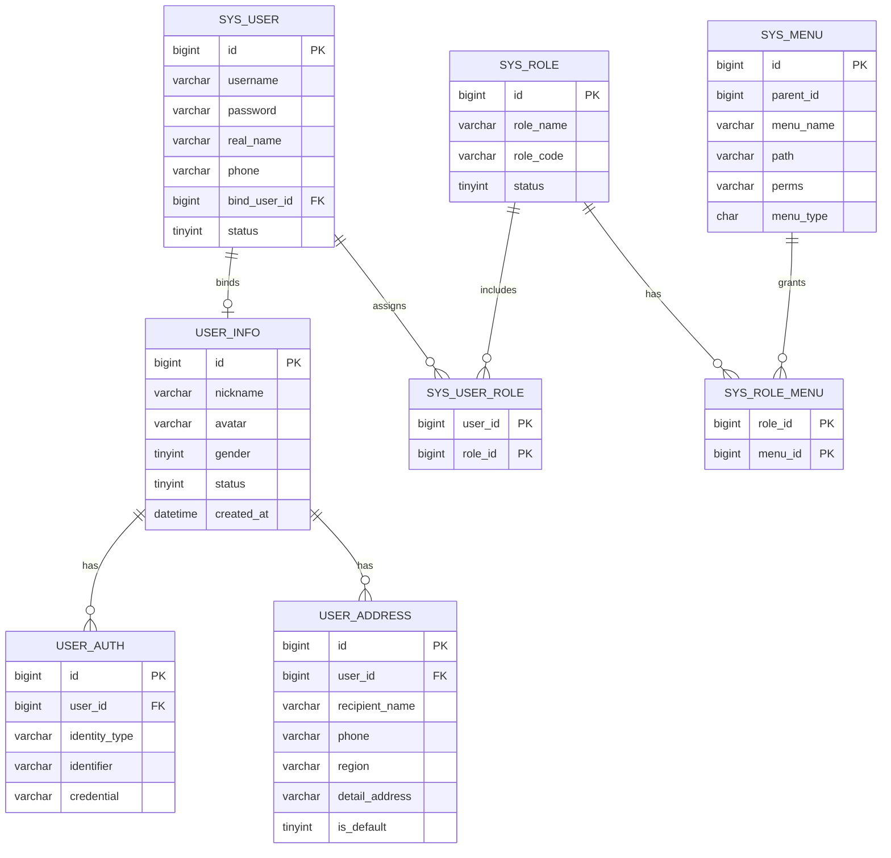
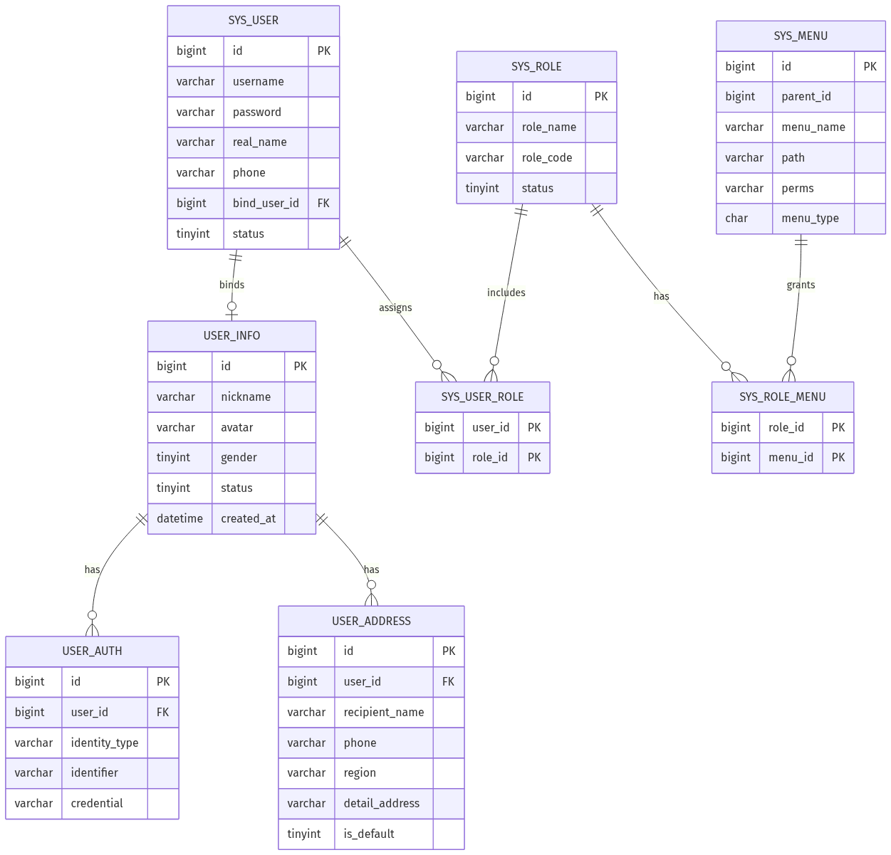

# 用户与权限中心数据库设计 (User Center DB Design)

本文档包含了系统用户中心（面向客户端）与后台管理权限系统（面向管理端）的最终表结构设计。系统去除了早期讨论的代祭扫特异性字段，完全按照**标准高扩展性电商架构**进行设计，并保留了“小程序兼顾管理平台”的身份双轨制设计。

## 一、 实体关系图 (ER Diagram)



> **注**：如果您的编辑器不支持 Mermaid 语法渲染，请参考下方的高清实体关系图：


## 二、 核心设计说明

1. **去除非标准业务字段**：`user_address` 表已回归纯粹的电商物流收货地址结构，去除了前期讨论的墓园特殊字段，保证商城逻辑的通用性。
2. **账号鉴权解耦**：客户端所有的鉴权方式（微信授权、手机验证码、账号密码）全部下沉至 `user_auth`。
3. **管理端小程序化支持（bind_user_id）**：`sys_user` 保留了 `bind_user_id`。如果某店长在使用小程序时，后端检测到他的 `user_info.id` 与某个正常的 `sys_user` 绑定，则前端可动态展示“管理后台入口”并赋予其后台接口操作权限，实现真正的身份融合。

## 三、 数据库建表 SQL (DDL)

```sql
-- ==========================================================
-- 第一部分：C端用户中心体系（标准电商用户）
-- ==========================================================

-- 1. 用户基础信息表 (代表一个物理人)
CREATE TABLE `user_info` (
  `id` bigint(20) NOT NULL COMMENT '用户全局主键ID（建议微服务代码中使用MyBatis-Plus雪花算法生成）',
  `nickname` varchar(50) DEFAULT '普通用户' COMMENT '用户昵称',
  `avatar` varchar(255) DEFAULT '' COMMENT '头像链接（一般关联到 file_db 中的文件或直接存URL）',
  `gender` tinyint(1) DEFAULT '0' COMMENT '性别：0未知，1男，2女',
  `status` tinyint(1) DEFAULT '1' COMMENT '账户状态：1正常，0禁用（黑名单）',
  `created_at` datetime DEFAULT CURRENT_TIMESTAMP COMMENT '注册时间',
  `updated_at` datetime DEFAULT CURRENT_TIMESTAMP ON UPDATE CURRENT_TIMESTAMP COMMENT '最后更新时间',
  PRIMARY KEY (`id`)
) ENGINE=InnoDB DEFAULT CHARSET=utf8mb4 COMMENT='用户基础信息表';

-- 2. 用户授权登录表 (多端登录支持)
CREATE TABLE `user_auth` (
  `id` bigint(20) NOT NULL AUTO_INCREMENT COMMENT '自增主键',
  `user_id` bigint(20) NOT NULL COMMENT '关联 user_info 表的 id',
  `identity_type` varchar(30) NOT NULL COMMENT '登录类型：例如 phone(手机), wechat_mini(微信小程序), password(账密)',
  `identifier` varchar(100) NOT NULL COMMENT '唯一标识符：具体的手机号、微信OpenID等',
  `credential` varchar(255) DEFAULT '' COMMENT '安全凭证：加密后的密码。如果是微信授权这种无密码登录，可为空',
  `created_at` datetime DEFAULT CURRENT_TIMESTAMP COMMENT '绑定时间',
  PRIMARY KEY (`id`),
  UNIQUE KEY `uk_type_identifier` (`identity_type`,`identifier`), -- 确保同一种登录类型下，账号(如手机号)不能重复
  KEY `idx_user_id` (`user_id`) -- 加快用户查询自己绑定了哪些登录方式的速度
) ENGINE=InnoDB DEFAULT CHARSET=utf8mb4 COMMENT='多端用户授权登录表';

-- 3. 用户收货地址表 (标准商城物流地址)
CREATE TABLE `user_address` (
  `id` bigint(20) NOT NULL AUTO_INCREMENT COMMENT '自增主键',
  `user_id` bigint(20) NOT NULL COMMENT '关联 user_info 表的 id，该地址属于哪个用户',
  `recipient_name` varchar(50) NOT NULL COMMENT '收货人姓名',
  `phone` varchar(20) NOT NULL COMMENT '收货人联系电话',
  `region` varchar(100) NOT NULL COMMENT '省市区(例如：辽宁省 大连市 甘井子区)',
  `detail_address` varchar(200) NOT NULL COMMENT '详细地址(例如：XX小区2栋301)',
  `is_default` tinyint(1) DEFAULT '0' COMMENT '是否默认地址：1是，0否',
  `created_at` datetime DEFAULT CURRENT_TIMESTAMP COMMENT '创建时间',
  `updated_at` datetime DEFAULT CURRENT_TIMESTAMP ON UPDATE CURRENT_TIMESTAMP COMMENT '最后修改时间',
  PRIMARY KEY (`id`),
  KEY `idx_user_id` (`user_id`) -- 根据用户查询其名下的所有地址
) ENGINE=InnoDB DEFAULT CHARSET=utf8mb4 COMMENT='用户收货地址表';


-- ==========================================================
-- 第二部分：B端管理权限体系（RBAC模型 + 身份双轨制）
-- ==========================================================

-- 4. 后台管理员/员工表 (含身份双轨制绑定)
CREATE TABLE `sys_user` (
  `id` bigint(20) NOT NULL AUTO_INCREMENT COMMENT '后台账号主键ID',
  `username` varchar(50) NOT NULL COMMENT '后台登录账号',
  `password` varchar(100) NOT NULL COMMENT '后台登录密码(需用BCryptPasswordEncoder加密)',
  `real_name` varchar(50) NOT NULL COMMENT '真实姓名/员工称呼',
  `phone` varchar(20) DEFAULT NULL COMMENT '员工联系电话',
  `bind_user_id` bigint(20) DEFAULT NULL COMMENT '【核心】绑定的C端 user_info.id。如果绑定了，该账号不仅能登录电脑后台，还能在小程序端显示管理台入口',
  `status` tinyint(1) DEFAULT '1' COMMENT '状态：1正常，0禁用(如离职)',
  `created_at` datetime DEFAULT CURRENT_TIMESTAMP COMMENT '创建时间',
  `updated_at` datetime DEFAULT CURRENT_TIMESTAMP ON UPDATE CURRENT_TIMESTAMP COMMENT '最后修改时间',
  PRIMARY KEY (`id`),
  UNIQUE KEY `uk_username` (`username`), -- 后台账号必须唯一
  UNIQUE KEY `uk_bind_user_id` (`bind_user_id`) -- 确保一个C端用户只能绑定一个B端员工身份
) ENGINE=InnoDB DEFAULT CHARSET=utf8mb4 COMMENT='后台员工与管理员表';

-- 5. 系统角色表
CREATE TABLE `sys_role` (
  `id` bigint(20) NOT NULL AUTO_INCREMENT COMMENT '角色ID',
  `role_name` varchar(50) NOT NULL COMMENT '角色名称（如：超级管理员、店长、客服）',
  `role_code` varchar(50) NOT NULL COMMENT '角色权限编码，供SpringSecurity使用（如：ADMIN, SHOP_MANAGER）',
  `status` tinyint(1) DEFAULT '1' COMMENT '角色状态：1正常，0停用',
  `created_at` datetime DEFAULT CURRENT_TIMESTAMP COMMENT '创建时间',
  PRIMARY KEY (`id`)
) ENGINE=InnoDB DEFAULT CHARSET=utf8mb4 COMMENT='系统角色表';

-- 6. 菜单与权限表
CREATE TABLE `sys_menu` (
  `id` bigint(20) NOT NULL AUTO_INCREMENT COMMENT '菜单ID',
  `parent_id` bigint(20) DEFAULT '0' COMMENT '父级菜单ID，顶级菜单为0',
  `menu_name` varchar(50) NOT NULL COMMENT '菜单名称（如：商品管理、订单发货）',
  `path` varchar(200) DEFAULT '' COMMENT '前端Vue路由地址',
  `component` varchar(255) DEFAULT NULL COMMENT '前端Vue组件路径',
  `perms` varchar(100) DEFAULT NULL COMMENT '后端权限标识（如：goods:list, order:send）',
  `menu_type` char(1) DEFAULT '' COMMENT '菜单类型：M目录，C菜单，F按钮',
  `icon` varchar(100) DEFAULT '#' COMMENT '菜单图标',
  `sort_order` int(4) DEFAULT '0' COMMENT '显示排序，越小越靠前',
  PRIMARY KEY (`id`)
) ENGINE=InnoDB DEFAULT CHARSET=utf8mb4 COMMENT='系统菜单与权限表';

-- 7. 管理员-角色关联表 (多对多)
CREATE TABLE `sys_user_role` (
  `user_id` bigint(20) NOT NULL COMMENT '关联 sys_user 表 ID',
  `role_id` bigint(20) NOT NULL COMMENT '关联 sys_role 表 ID',
  PRIMARY KEY (`user_id`,`role_id`)
) ENGINE=InnoDB DEFAULT CHARSET=utf8mb4 COMMENT='后台管理员与角色关联表';

-- 8. 角色-菜单/权限关联表 (多对多)
CREATE TABLE `sys_role_menu` (
  `role_id` bigint(20) NOT NULL COMMENT '关联 sys_role 表 ID',
  `menu_id` bigint(20) NOT NULL COMMENT '关联 sys_menu 表 ID',
  PRIMARY KEY (`role_id`,`menu_id`)
) ENGINE=InnoDB DEFAULT CHARSET=utf8mb4 COMMENT='角色与菜单权限关联表';
```
