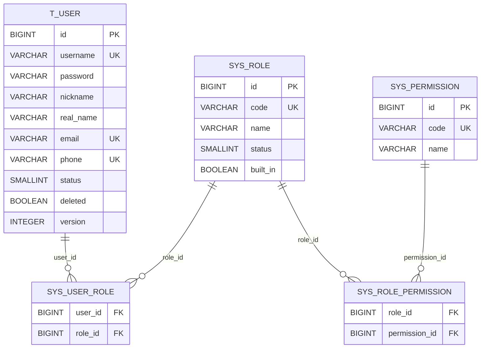

# 用户与权限数据库设计

## 1. 设计目标

该模型只描述通用身份域，不包含任何毕业设计选题业务字段。所有结构由 Flyway 迁移文件 `back/user-service/src/main/resources/db/migration` 管理。

## 2. 关系模型

## 3. 表说明

### 3.1 `t_user`

| 字段 | 类型 | 约束/说明 |
|---|---|---|
| `id` | BIGINT | 主键，MyBatis-Plus 雪花 ID |
| `username` | VARCHAR(32) | 登录名，未删除记录中忽略大小写唯一 |
| `password` | VARCHAR(100) | BCrypt 哈希，不是明文 |
| `nickname` / `real_name` | VARCHAR(50) | 可选展示名与实名 |
| `email` | VARCHAR(254) | 可选，未删除记录中忽略大小写唯一 |
| `phone` | VARCHAR(20) | 可选，未删除记录中唯一 |
| `avatar` | VARCHAR(500) | 头像 URL |
| `status` | SMALLINT | 1 正常，0 禁用 |
| `last_login_at/ip` | TIMESTAMP / VARCHAR | 最近登录审计 |
| `password_changed_at` | TIMESTAMP | 最近改密时间 |
| `created_at/updated_at` | TIMESTAMP | 应用自动填充 |
| `deleted` | BOOLEAN | MyBatis-Plus 逻辑删除 |
| `version` | INTEGER | 乐观锁版本 |

### 3.2 RBAC 表

- `sys_role`：角色编码、名称、状态与内置标记；
- `sys_permission`：稳定的权限码字典；
- `sys_user_role`：联合主键 `(user_id, role_id)`；
- `sys_role_permission`：联合主键 `(role_id, permission_id)`。

关联表外键使用 `ON DELETE CASCADE`。用户业务删除是逻辑删除，因此应用同时显式清理 `sys_user_role`。

## 4. 索引与一致性

- `LOWER(username) WHERE deleted = FALSE` 唯一；
- `LOWER(email) WHERE deleted = FALSE AND email IS NOT NULL` 唯一；
- `phone WHERE deleted = FALSE AND phone IS NOT NULL` 唯一；
- `(status, created_at DESC) WHERE deleted = FALSE` 支持管理分页；
- 两张关联表均为联合主键，并为反向查询列建立索引。

应用层会提前检查唯一性以返回具体错误码；并发请求仍由数据库唯一索引最终裁决。

## 5. 初始化数据

`V1__create_user_and_rbac_schema.sql` 初始化 `user`、`admin` 角色和系统管理权限，并把全部当前权限分配给 `admin`。管理员账号本身不写入 SQL，必须通过环境变量初始化。

## 6. 迁移规则

1. 已执行的迁移不可修改或重命名；
2. 表结构或权限字典变更新增 `V2__...sql`、`V3__...sql`；
3. 迁移必须可在全新库执行，并说明旧数据兼容策略；
4. 生产迁移前备份并执行 `flyway validate`；
5. 不使用 `ddl-auto` 或启动时任意重建表。
