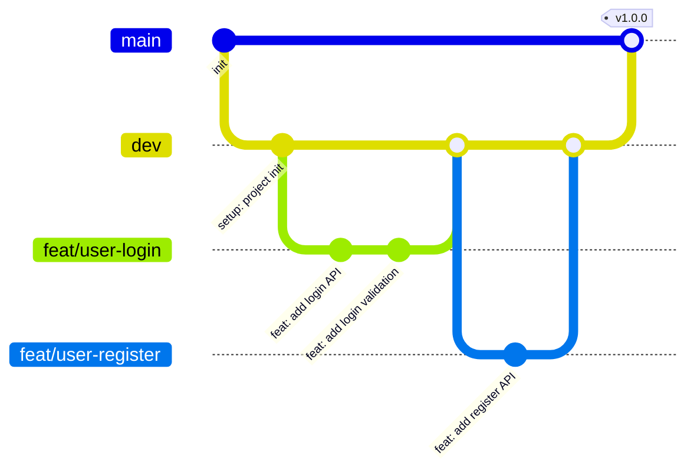

# Git 提交规范

> **文档版本**：v1.0.0 | **最后更新**：2026-06-07 | **状态**：已完成

---

## 1. 分支命名规范

### 1.1 分支类型

| 分支类型 | 命名格式 | 示例 | 说明 |
|----------|----------|------|------|
| 主分支 | `main` | `main` | 生产环境代码，随时可发布，不允许直接推送 |
| 开发分支 | `dev` | `dev` | 集成分支，所有功能开发完成后合并至此 |
| 功能分支 | `feat/{功能名}` | `feat/user-login` | 开发新功能，从 dev 切出，完成后合并回 dev |
| 修复分支 | `fix/{bug描述}` | `fix/login-password-error` | 修复 Bug，从 dev 或 main 切出 |
| 热修复分支 | `hotfix/{描述}` | `hotfix/token-expire-issue` | 紧急修复生产 Bug，从 main 切出 |
| 文档分支 | `docs/{描述}` | `docs/api-documentation` | 仅修改文档，不涉及代码 |
| 重构分支 | `refactor/{描述}` | `refactor/user-service-layer` | 代码重构，不改变功能 |
| 发布分支 | `release/{版本号}` | `release/1.0.0` | 发布准备，从 dev 切出 |

### 1.2 分支命名规则

- 全小写，单词间使用连字符（`-`）分隔
- 描述要简洁、有意义，体现功能或问题本质
- 功能分支命名参考功能需求 ID（如 `feat/us-001-user-register`）

---

## 2. 工作流程



### 2.1 标准开发流程

```bash
# 1. 从 dev 分支切出功能分支
git checkout dev
git pull origin dev
git checkout -b feat/user-login

# 2. 开发代码，提交 commit
git add .
git commit -m "feat(user): add login API endpoint"

# 3. 推送功能分支到远程
git push origin feat/user-login

# 4. 创建 Pull Request（从 feat/user-login 合并到 dev）
# 在代码仓库平台（GitHub/Gitee）操作

# 5. Code Review 通过后合并，删除功能分支
git branch -d feat/user-login
```

---

## 3. Commit Message 规范

### 3.1 格式规范

遵循 [Conventional Commits 规范](https://www.conventionalcommits.org/)：

```
<type>(<scope>): <subject>

[body]

[footer]
```

| 部分 | 是否必须 | 说明 |
|------|----------|------|
| `type` | ✅ 必须 | 提交类型（见下表） |
| `scope` | ❌ 可选 | 影响范围（如模块名） |
| `subject` | ✅ 必须 | 简短描述，不超过 72 字符，动词开头 |
| `body` | ❌ 可选 | 详细说明（为什么这样做） |
| `footer` | ❌ 可选 | 关联 Issue、Breaking Change 说明 |

### 3.2 Commit Type 类型

| Type | 中文含义 | 使用场景 |
|------|----------|----------|
| `feat` | 新功能 | 添加新的业务功能 |
| `fix` | Bug 修复 | 修复功能 Bug |
| `docs` | 文档 | 仅修改文档（README、注释等） |
| `style` | 代码格式 | 格式化、补充分号等不影响功能的修改 |
| `refactor` | 代码重构 | 既不修复 Bug 也不添加功能的代码改动 |
| `perf` | 性能优化 | 提升性能的代码改动 |
| `test` | 测试 | 添加或修改测试代码 |
| `chore` | 构建/工具 | 构建脚本、工具配置等修改 |
| `ci` | CI/CD | CI 配置文件修改 |
| `revert` | 撤销 | 撤销之前的 commit |
| `build` | 构建系统 | 影响构建系统或外部依赖的修改（Maven/npm） |

### 3.3 Commit 示例

```bash
# ✅ 正确示例

# 新增功能
git commit -m "feat(user): add user registration API"
git commit -m "feat(gateway): implement JWT authentication filter"
git commit -m "feat(user): add Redis cache for user info query"

# Bug 修复
git commit -m "fix(user): fix password comparison logic error"
git commit -m "fix(gateway): fix CORS header missing on error response"

# 文档更新
git commit -m "docs: update API documentation for user service"
git commit -m "docs(readme): add project setup instructions"

# 代码重构
git commit -m "refactor(user): extract user validation to separate method"

# 性能优化
git commit -m "perf(user): add index on username column"

# 依赖更新
git commit -m "build(deps): upgrade spring-boot to 4.0.6"

# 配置变更
git commit -m "chore: add .gitignore for IntelliJ IDEA files"
```

```bash
# ❌ 错误示例（禁止使用）
git commit -m "update"              # 太模糊，无法理解改了什么
git commit -m "修改了登录接口"      # 不符合格式规范
git commit -m "fix bug"             # 未说明什么 bug
git commit -m "WIP"                 # 工作进行中，应使用草稿 PR
```

### 3.4 带 Body 的完整示例

```bash
git commit -m "feat(user): add bcrypt password encryption

Use BCryptPasswordEncoder to hash passwords before storing to database.
Plain text passwords are never stored.

Resolves: #12
```

---

## 4. Pull Request（PR）规范

### 4.1 PR 标题

PR 标题遵循与 commit message 相同的格式：

```
feat(user): add user login and registration API
```

### 4.2 PR 描述模板

```markdown
## 变更说明

简要说明本次 PR 的功能或修复内容。

## 变更类型

- [ ] 新功能（feat）
- [ ] Bug 修复（fix）
- [ ] 文档更新（docs）
- [ ] 代码重构（refactor）
- [ ] 性能优化（perf）
- [ ] 其他

## 测试说明

描述已进行的测试：
- [ ] 单元测试通过
- [ ] 接口测试通过
- [ ] 本地联调测试通过

## 相关 Issue

Closes #xxx
```

### 4.3 Code Review 规范

| 规则 | 说明 |
|------|------|
| 至少一人 Review | 合并前需要至少 1 人 Approve |
| 自测通过 | PR 创建者需要先在本地测试通过 |
| 小而聚焦 | 单个 PR 控制在 500 行代码以内，超出需拆分 |
| 及时响应 | Review 意见 24 小时内响应 |

---

## 5. Tag（版本标签）规范

版本号遵循 [语义化版本 SemVer](https://semver.org/lang/zh-CN/)：`v{MAJOR}.{MINOR}.{PATCH}`

| 版本部分 | 递增场景 | 示例 |
|----------|----------|------|
| `MAJOR` | 不兼容的 API 破坏性变更 | v1.0.0 → v2.0.0 |
| `MINOR` | 向后兼容的新功能 | v1.0.0 → v1.1.0 |
| `PATCH` | 向后兼容的 Bug 修复 | v1.0.0 → v1.0.1 |

```bash
# 创建版本标签
git tag -a v1.0.0 -m "Release v1.0.0: 用户服务基础功能完成"
git push origin v1.0.0
```

---

## 6. .gitignore 规范

项目根目录的 `.gitignore` 应包含以下内容：

```gitignore
# Maven 构建产物
target/
*.jar
*.war
*.class

# IDEA 项目文件
.idea/
*.iml
*.iws
*.ipr

# VSCode 项目文件
.vscode/

# 操作系统文件
.DS_Store
Thumbs.db

# 日志文件
*.log
logs/

# 环境配置文件（包含敏感信息，不提交）
application-prod.yaml
.env

# Spring Boot 配置（本地开发覆盖配置）
application-local.yaml
```
